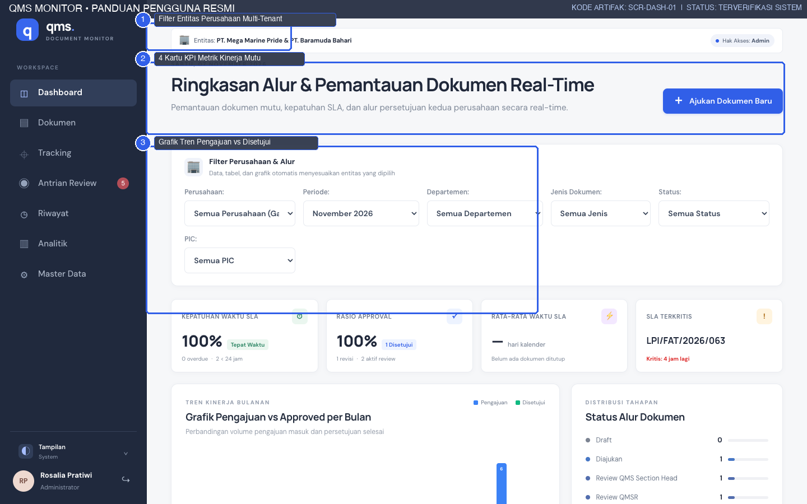
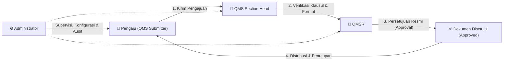
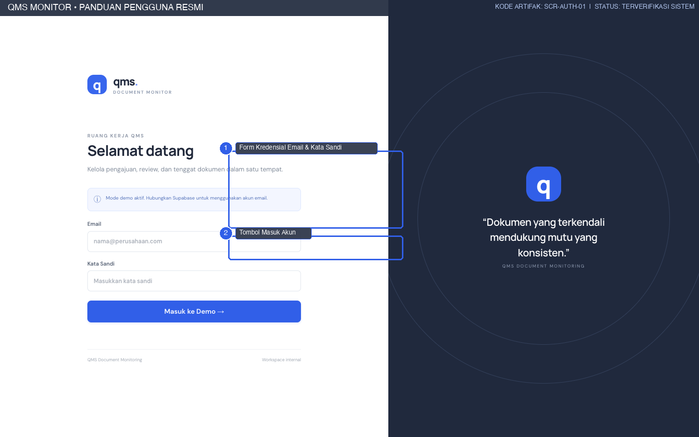
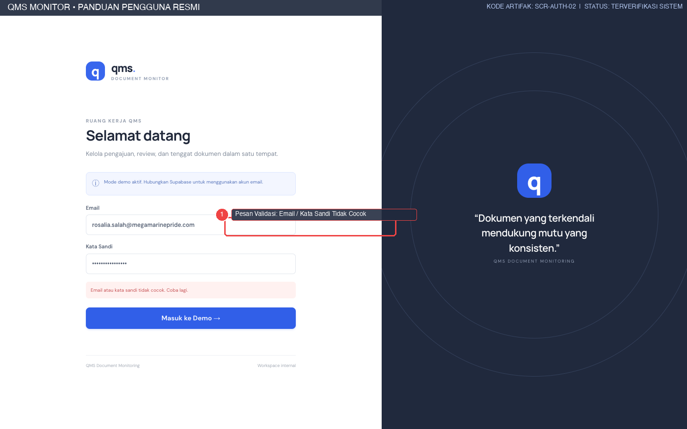
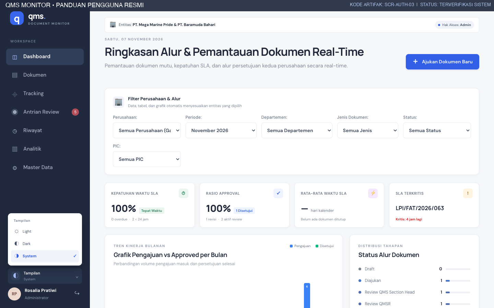
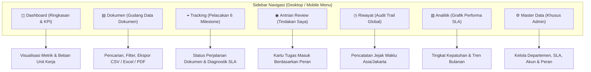
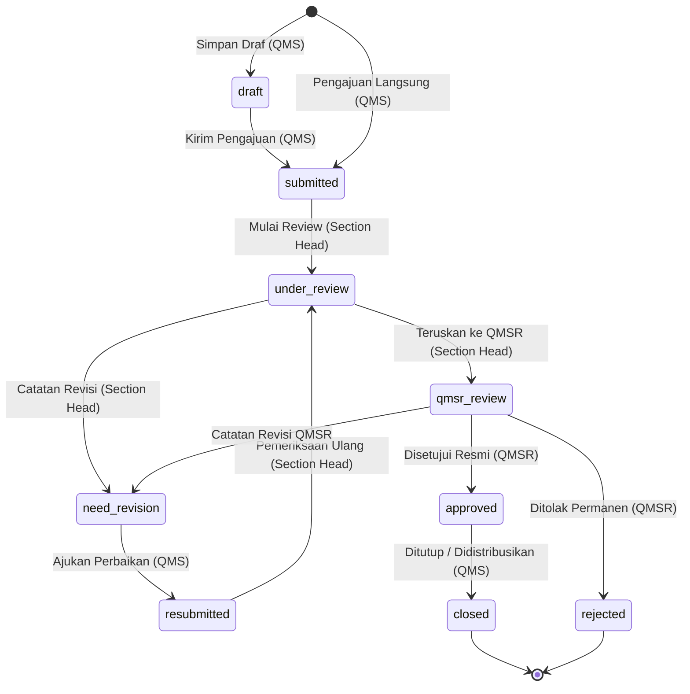
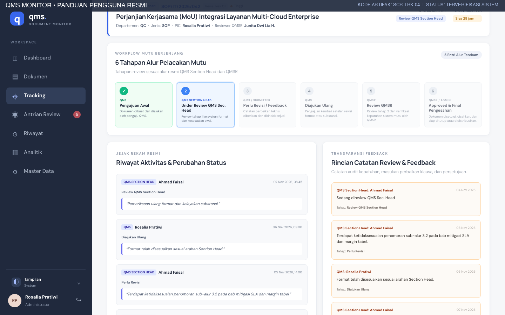
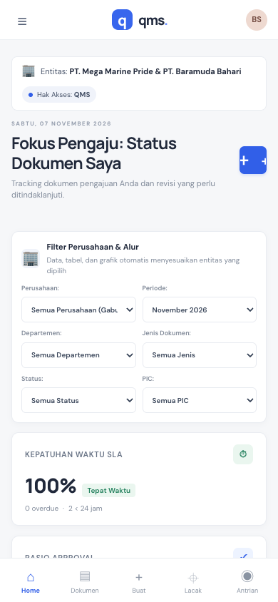

# PANDUAN RINGKAS DAN PENGENALAN SISTEM
## QMS MONITOR — SISTEM PEMANTAUAN DOKUMEN MUTU
**PT. MEGA MARINE PRIDE & PT. BARAMUDA BAHARI**

---

| Informasi Dokumen | Detail |
|---|---|
| **Kode Dokumen** | `QMS-MMP-MNL-001` |
| **Versi Dokumen** | 1.0 (Edisi Produksi) |
| **Tanggal Efektif** | 7 November 2026 |
| **Penyusun** | Tim Dokumentasi Teknis QMS Monitor |
| **Penelaah / PIC** | Rosalia Pratiwi |
| **Klasifikasi Akses** | Internal Enterprise Restricted |
| **Zona Waktu Acuan** | Asia/Jakarta (WIB) |

---

## 1. PENDAHULUAN & TUJUAN SISTEM

### 1.1 Latar Belakang
Dalam rangka memperkuat kepatuhan terhadap standar sistem manajemen mutu (ISO 9001:2015, BRCGS, HACCP) pada unit pengolahan dan operasional maritim di **PT. Mega Marine Pride** dan **PT. Baramuda Bahari**, aplikasi **QMS Monitor** hadir sebagai platform sentral pemantauan dan pengelolaan dokumen mutu secara digital, aman, dan terukur secara real-time.

Aplikasi ini menggantikan mekanisme sirkulasi dokumen konvensional menjadi alur kerja terkendali (*controlled workflow*) dengan penghitungan Service Level Agreement (SLA) otomatis berbasis hari kerja dan jam operasional kantor.

*Gambar 1.1: Tampilan Utama Dashboard Eksekutif QMS Monitor dengan Navigasi Terpadu dan Visualisasi Metrik KPI.*

### 1.2 Tujuan Panduan Ringkas
Buku panduan ini ditujukan bagi seluruh pengguna di kedua perusahaan untuk:
1. Memahami arsitektur umum, hak akses peran (*Role-Based Access Control*), dan alur persetujuan dokumen.
2. Melakukan login dan navigasi dasar pada lingkungan desktop maupun perangkat seluler (*responsive*).
3. Membaca indikator status alur dan kepatuhan SLA secara mandiri.
4. Mengetahui langkah eskalasi dan kontak bantuan jika terjadi kendala operasional.

---

## 2. MATRIKS PERAN PENGGUNA (ROLE-BASED ACCESS CONTROL)

Sistem membagi pengguna ke dalam 4 (empat) peran utama dengan wewenang yang tegas dan terisolasi:

| Peran Pengguna | Deskripsi Tugas Utama | Ruang Lingkup Wewenang Dokumen | Batasan Akses |
|---|---|---|---|
| **QMS Submitter** (*Pengaju*) | Membuat draf, melengkapi metadata, mengunggah lampiran, merevisi jika ada catatan, dan menutup dokumen yang disetujui. | Hanya dapat melihat dan mengelola dokumen yang dibuat oleh dirinya sendiri. | Tidak dapat mereview dokumen milik pengguna lain atau memberikan persetujuan akhir. |
| **QMS Section Head** (*Pemeriksa Tahap 1*) | Memeriksa kelayakan format, konsistensi istilah, margin tabel, dan substansi klausul sebelum diteruskan ke QMSR. | Melihat seluruh dokumen aktif yang diajukan di perusahaannya (status `submitted`, `resubmitted`, `under_review`). | Tidak dapat memberikan status final *Approved* atau mengelola master akun. |
| **QMSR** (*Quality Management System Representative*) | Melakukan evaluasi kepatuhan klausul standar mutu tingkat korporat dan menerbitkan persetujuan resmi (*final approval*) atau penolakan. | Memeriksa seluruh dokumen yang ditugaskan kepadanya pada tahap `qmsr_review`. | Tidak dapat mengubah metadata asli pengajuan submitter secara sepihak tanpa catatan review. |
| **Administrator** (*Pengelola Sistem*) | Memantau seluruh siklus dokumen kedua entitas, mengelola akun personil, mengatur master departemen, kategori dokumen, reviewer, dan jejak audit. | Akses global tanpa batas (*Full Access*) terhadap seluruh data PT. Mega Marine Pride dan PT. Baramuda Bahari. | Wajib menjaga integritas data audit dan tidak melakukan reset data bisnis produksi. |

---

## 3. PROSEDUR AUTENTIKASI & MASUK SISTEM

### 3.1 Mengakses Halaman Login
1. Buka browser resmi (Google Chrome, Microsoft Edge, atau Safari versi terkini).
2. Akses tautan resmi portal: `https://qms-ruddy.vercel.app/login` (atau lingkungan staging resmi perusahaan).
3. Halaman login modern akan tampil dengan formulir kredensial di sebelah kiri dan kutipan filosofi mutu di sebelah kanan.

*Gambar 3.1: Halaman Login Utama QMS Monitor (SCR-AUTH-01) dengan kolom Email ① dan Tombol Masuk ②.*

### 3.2 Langkah-Langkah Masuk (Sign-In)
- **Langkah 1:** Masukkan alamat email perusahaan terdaftar pada kolom **Email** (contoh: `nama.karyawan@megamarinepride.com` atau `@baramuda.com`).
- **Langkah 2:** Masukkan kata sandi akun pada kolom **Kata Sandi**.
- **Langkah 3:** Klik tombol **Masuk →** (atau **Masuk ke Demo →** jika berada dalam mode evaluasi tanpa Supabase aktif).
- **Hasil yang Diharapkan:** Sistem memvalidasi token sesi pengguna, mengarahkan ke halaman Dashboard sesuai peran akun, dan menampilkan nama pengguna serta unit kerja pada sidebar kiri.

### 3.3 Penanganan Kesalahan Kredensial
Jika email atau kata sandi yang dimasukkan tidak cocok, sistem akan menampilkan spanduk peringatan merah di atas tombol login:

*Gambar 3.2: Notifikasi Kesalahan Validasi Login (SCR-AUTH-02) saat kredensial tidak sesuai ①.*

> [!WARNING]
> Demi keamanan, jangan membagikan kata sandi kepada rekan kerja lain. Setiap tindakan pengajuan, catatan review, dan persetujuan dicatat secara permanen dalam audit trail berdasarkan akun yang masuk.

### 3.4 Pengaturan Tema Tampilan (Terang / Gelap / Sistem)
Pengguna dapat menyesuaikan kenyamanan visual layar dengan memilih mode tema tampilan melalui pojok kiri bawah sidebar:
1. Klik tombol **Tampilan** pada panel akun sidebar kiri.
2. Pilih mode: **Light** (Tema terang bernuansa abu-abu modern), **Dark** (Tema gelap kontras tinggi untuk ruangan redup), atau **System** (Mengikuti preferensi sistem operasi).

*Gambar 3.3: Pemilih Tema Antarmuka (SCR-AUTH-03) pada Sidebar Navigasi.*

---

## 4. ANATOMI NAVIGASI & STRUKTUR HALAMAN

Antarmuka QMS Monitor dirancang menggunakan prinsip *Enterprise Density with Modern Clean Air*, memprioritaskan keterbacaan data tabel dan status SLA.

### 4.1 Menu-Menu Utama
- **Dashboard (`/`):** Pusat kendali ringkasan metrik perusahaan, perbandingan pengajuan bulanan, dan status dokumen terkini.
- **Dokumen (`/documents`):** Repositori komprehensif seluruh pengajuan dokumen mutu yang dilengkapi filter multi-facet serta fasilitas unduh CSV, Excel, dan layout cetak resmi.
- **Tracking (`/tracking`):** Antarmuka visual 6 tahapan siklus hidup dokumen (*milestone stepper*), rincian SLA waktu Asia/Jakarta, dan catatan koreksi reviewer.
- **Antrian Review (`/actions`):** Lembar kerja personal terfilter yang mengelompokkan berkas berdasarkan prioritas tindakan (Menunggu Review, Sedang Direview, Perlu Revisi, dan Dokumen Kritis).
- **Riwayat (`/history`):** Catatan historis seluruh perubahan status yang terjadi di kedua entitas perusahaan secara kronologis.
- **Analitik (`/analytics`):** Visualisasi analitik kepatuhan SLA persentase dan volume beban dokumen per departemen.
- **Master Data (`/master-data`):** Modul konfigurasi sistem khusus Administrator untuk menambah unit kerja, standar SLA per jenis dokumen, aktivasi reviewer, dan manajemen pengguna.

---

## 5. MEMAHAMI SIKLUS HIDUP & STATUS DOKUMEN MUTU

Setiap dokumen mutu yang diajukan ke dalam sistem akan melewati 7 (tujuh) status baku yang terstandarisasi:

### 5.1 Arti Warna Badge Status
1. **Draf (`draft` / Abu-abu):** Dokumen baru disimpan oleh pengaju dan belum masuk ke dalam hitungan hari kerja SLA.
2. **Diajukan (`submitted` / Biru Muda):** Dokumen telah resmi dikirim oleh QMS Submitter dan masuk ke dalam antrian awal Section Head.
3. **Sedang Direview (`under_review` / Ungu):** Pemeriksaan tahap 1 sedang dilakukan oleh Section Head.
4. **Perlu Revisi (`need_revision` / Kuning Amber):** Terdapat klausul, margin, atau lampiran yang salah. Dokumen dikembalikan ke pengaju untuk diperbaiki.
5. **Diajukan Kembali (`resubmitted` / Biru):** Dokumen revisi telah diunggah kembali oleh pengaju dan menunggu verifikasi ulang Section Head.
6. **Review QMSR (`qmsr_review` / Indigo):** Verifikasi tahap 1 lolos; berkas berada di meja QMSR untuk evaluasi kepatuhan mutu akhir.
7. **Disetujui (`approved` / Hijau):** QMSR menyetujui dokumen secara resmi. Tanggal persetujuan dikunci dalam sistem.
8. **Ditolak (`rejected` / Merah):** Pengajuan dibatalkan secara permanen karena tidak memenuhi kebijakan standar perusahaan.
9. **Ditutup (`closed` / Abu-abu Gelap):** Pengaju telah mengunduh berkas bertanda tangan dan mendistribusikan salinan terkendali ke unit kerja.

---

## 6. SISTEM PERHITUNGAN SLA (SERVICE LEVEL AGREEMENT)

### 6.1 Ketentuan Jam & Hari Kerja Asia/Jakarta
QMS Monitor menerapkan kalkulasi waktu nyata dengan parameter operasional sebagai berikut:
- **Zona Waktu:** Waktu Indonesia Barat (`Asia/Jakarta` / GMT+7).
- **Hari Kerja:** Senin hingga Jumat.
- **Hari Libur:** Sabtu, Minggu, dan Hari Libur Nasional Resmi Indonesia (dikeluarkan otomatis dari kalkulasi SLA).
- **Batas Jam Kantor (*Cut-Off Time*):** **17:00:00 WIB**.
- **Aturan Pengajuan Lewat Waktu:** Pengajuan yang dikirimkan setelah pukul 17:00 WIB otomatis mulai dihitung pada hari kerja berikutnya pukul 08:00 WIB.

### 6.2 Penyesuaian Prioritas Dokumen
Standar SLA dihitung berdasarkan jenis dokumen yang dipilih, lalu disesuaikan dengan skala prioritas:
- **Rendah (*Low*):** Ditambahkan +1 hari kerja toleransi.
- **Normal (*Medium*):** Mengikuti standar dasar jenis dokumen (misal SOP: 7 hari kerja, Form: 3 hari kerja).
- **Tinggi (*High*):** Dikurangi 1 hari kerja (minimum 1 hari kerja).
- **Kritis (*Critical*):** Ditargetkan selesai dalam **1 hari kerja** darurat.

*Gambar 6.1: Kotak Diagnostik SLA Terpadu (SCR-TRK-04) dengan Informasi Hari Kerja dan Status Kepatuhan.*

---

## 7. PENGGUNAAN PADA PERANGKAT MOBILE (SMARTPHONE)

Aplikasi QMS Monitor telah dioptimalkan secara penuh (*Mobile Responsive PWA*) agar personil lapangan, auditor, dan pimpinan dapat memantau dokumen di mana pun:

1. **Bilah Navigasi Bawah (*Bottom Bar*):** Akses cepat satu sentuhan ke Dashboard, Dokumen, Antrian Tugas, dan Tracking.
2. **Menu Hamburger Atas:** Sentuh ikon garis tiga (☰) di sudut kiri atas untuk membuka daftar navigasi lengkap.
3. **Kartu Dokumen Ringkas:** Seluruh data tabel otomatis diadaptasi menjadi kartu vertikal yang nyaman dibaca dengan satu tangan.

*Gambar 7.1: Tampilan Mobile Responsive QMS Monitor pada Smartphone (SCR-MOB-01).*

---

## 8. BANTUAN & KONTAK DUKUNGAN TEKNIS

Apabila Anda mengalami kendala seperti lupa kata sandi, akun terkunci, kesalahan penugasan reviewer, atau kegagalan unggah berkas:

- **Pengelola Mutu (PIC QMS):** Rosalia Pratiwi (`rosalia.pratiwi@megamarinepride.com`)
- **Dukungan Teknis & IT Helpdesk:** Tim IT Enterprise PT. Mega Marine Pride / PT. Baramuda Bahari
- **Jam Layanan Bantuan:** Senin – Jumat, 08:00 – 17:00 WIB
- **Pembaruan Sistem:** Informasi rilis dan changelog dapat dilihat langsung melalui tab Riwayat sistem.
