# PANDUAN PENGGUNA ADMINISTRATOR SISTEM
## QMS MONITOR — MODUL KONTROL ENTERPRISE & SUPERVISI MUTU
**PT. MEGA MARINE PRIDE & PT. BARAMUDA BAHARI**

---

| Informasi Dokumen | Detail |
|---|---|
| **Kode Dokumen** | `QMS-MMP-ADM-002` |
| **Versi Dokumen** | 1.0 (Edisi Produksi) |
| **Tanggal Efektif** | 7 November 2026 |
| **Otoritas Penerbit** | Quality Management Department & IT Systems |
| **Penyusun** | Lead QA & Technical Writer |
| **Penanggung Jawab Sistem** | Rosalia Pratiwi (Administrator Utama) |
| **Klasifikasi Keamanan** | Confidential — System Administrator Access Only |

---

## 1. PENDAHULUAN & WEWENANG ADMINISTRATOR

Modul Administrator QMS Monitor dirancang untuk memberikan kendali komprehensif atas tata kelola dokumen mutu di dua perusahaan manufaktur maritim: **PT. Mega Marine Pride** dan **PT. Baramuda Bahari**.

Sebagai Administrator Sistem, wewenang Anda meliputi:
1. **Pengelolaan Akun & Peran Pengguna:** Mendaftarkan personil baru, menugaskan peran (*Admin, QMS, QMS Section Head, QMSR*), mengubah profil, serta mengaktifkan atau menonaktifkan akses akun.
2. **Konfigurasi Master Data Workspace:** Menambah dan memelihara daftar unit kerja (*departemen*), jenis dokumen mutu beserta standar target hari kerja SLA, dan daftar personil reviewer aktif.
3. **Pengawasan Mutu Lintas Entitas (Multi-Tenant Supervision):** Memantau pengajuan dokumen dari seluruh departemen di kedua entitas tanpa sekat visibilitas, mendeteksi hambatan (*bottleneck*), dan memvalidasi ketepatan alur kerja.
4. **Audit Trail & Jejak Kepatuhan:** Memeriksa seluruh riwayat modifikasi, pencatatan tanggal persetujuan, dan catatan reviewer untuk kebutuhan audit sertifikasi berkala (ISO 9001:2015, HACCP, BRCGS).
5. **Ekspor & Pelaporan Data Terpadu:** Mengunduh data dokumen dalam format CSV terstruktur, buku kerja Excel (.xlsx), dan dokumen pratinjau cetak/PDF resmi.

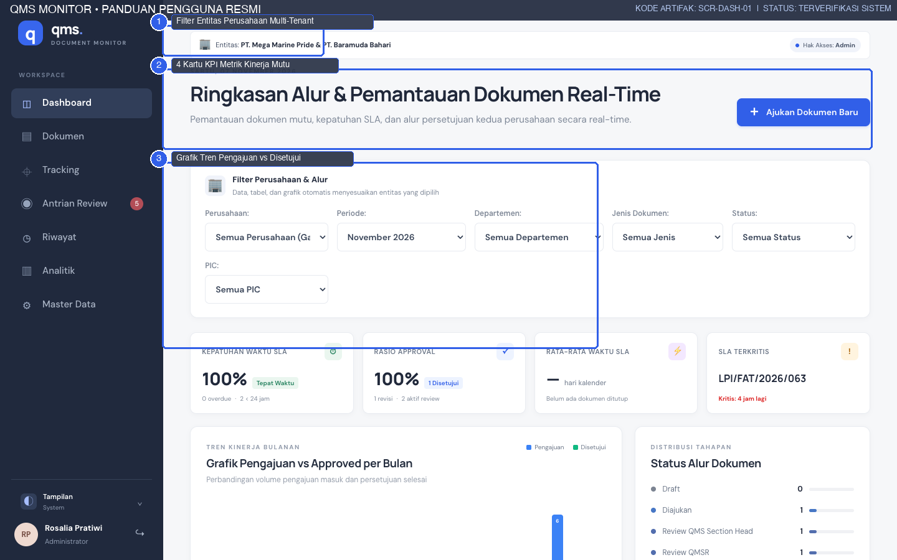
*Gambar 1.1: Dasbor Sentral Administrator (SCR-DASH-01) menampilkan Filter Entitas ①, Kartu Metrik KPI ②, dan Grafik Kinerja ③.*

---

## 2. DASBOR EKSEKUTIF & ANALITIK KINERJA MUTU

Dasbor Administrator menyajikan konsolidasi data waktu nyata dari seluruh transaksi mutu. 

### 2.1 Filter Multi-Perusahaan (Multi-Tenant Selector)
Pada bagian atas dasbor terdapat pemilih entitas yang memungkinkan Administrator beralih mode visibilitas:
- **Semua Perusahaan:** Menampilkan agregasi data gabungan PT. Mega Marine Pride dan PT. Baramuda Bahari.
- **PT. Baramuda Bahari:** Mengisolasi analisis dan antrian untuk fasilitas PT. Baramuda Bahari.
- **PT. Mega Marine Pride:** Mengisolasi analisis dan antrian untuk fasilitas PT. Mega Marine Pride.

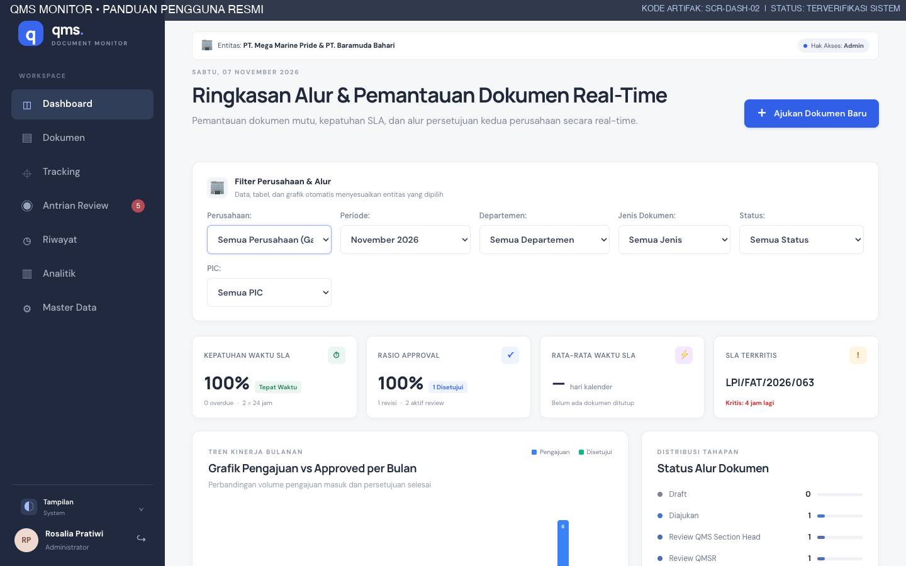
*Gambar 2.1: Pemilihan Filter Entitas Perusahaan pada Dasbor Administrator (SCR-DASH-02).*

### 2.2 Analisis 4 Metrik Kinerja Utama (KPI Cards)
Administrator wajib memantau 4 (empat) kartu metrik modern yang diperbarui secara otomatis setiap kali status dokumen berubah:

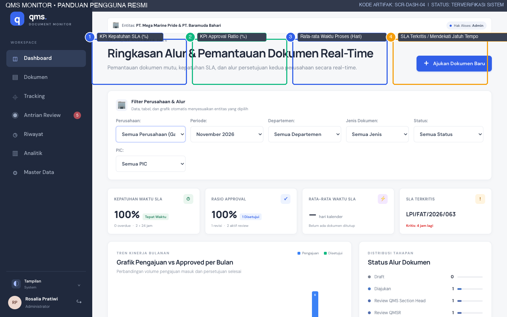
*Gambar 2.2: Rincian 4 Kartu KPI Metrik Kinerja Mutu (SCR-DASH-04).*

1. **Kepatuhan SLA (%):** Persentase dokumen yang berhasil diselesaikan dan disetujui dalam batas hari kerja yang ditetapkan.
   - *Formula:* $(\text{Jumlah Dokumen Tepat Waktu} / \text{Total Dokumen Selesai}) \times 100\%$.
   - *Target Standar Mutu:* $\ge 90\%$.
2. **Approval Ratio (%):** Rasio efektivitas pengajuan yang disetujui terhadap seluruh dokumen yang diajukan.
   - *Formula:* $(\text{Dokumen Approved} / \text{Total Pengajuan}) \times 100\%$.
3. **Rata-rata Waktu Proses (Hari):** Rata-rata durasi hari kerja kalender Jakarta yang dibutuhkan sejak pengajuan awal hingga penutupan resmi.
4. **SLA Terkritis / Mendekati Jatuh Tempo:** Jumlah dokumen aktif yang saat ini telah melewati batas hari kerja (*overdue*) atau tersisa kurang dari 1 hari kerja (*due soon*).

### 2.3 Grafik Batang Tren Kinerja Bulanan
Diagram batang interaktif memvisualisasikan perbandingan jumlah dokumen yang diajukan (*Batang Biru*) dengan dokumen yang berhasil disetujui (*Batang Hijau*) dalam 6 bulan terakhir.

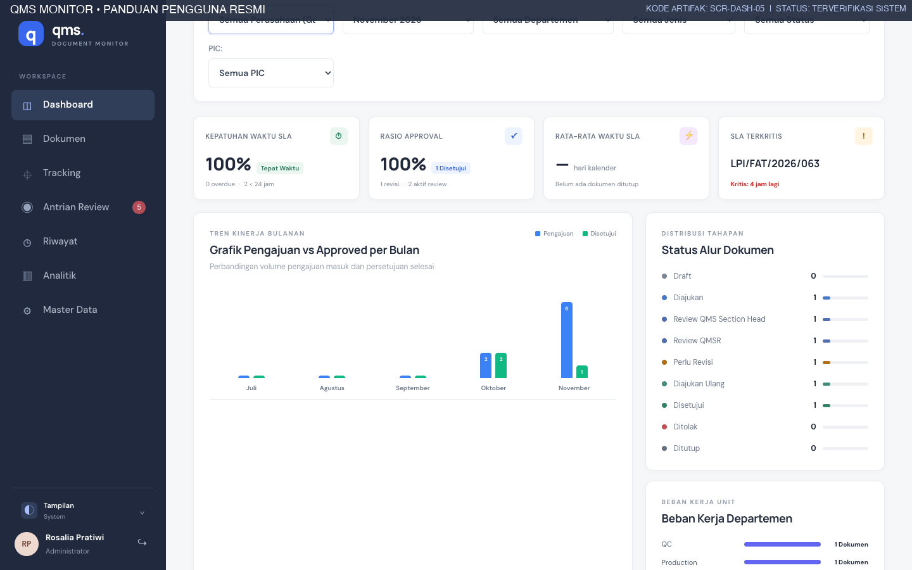
*Gambar 2.3: Grafik Diagram Batang Tren Pengajuan vs Disetujui (SCR-DASH-05).*

### 2.4 Distribusi Status Alur & Beban Unit Kerja
Pada panel bawah dasbor terdapat *distribution grid*:
- **Tahapan Dokumen Mutu:** Menunjukkan proporsi jumlah berkas pada status Draf, Diajukan, Sedang Direview, Perlu Revisi, Review QMSR, Disetujui, dan Ditutup.
- **Distribusi Beban Kerja per Departemen:** Mengidentifikasi departemen dengan volume penerbitan dokumen tertinggi (misal: QC, QA, Purchasing, Production, Warehouse) guna memitigasi kelebihan beban kerja reviewer.

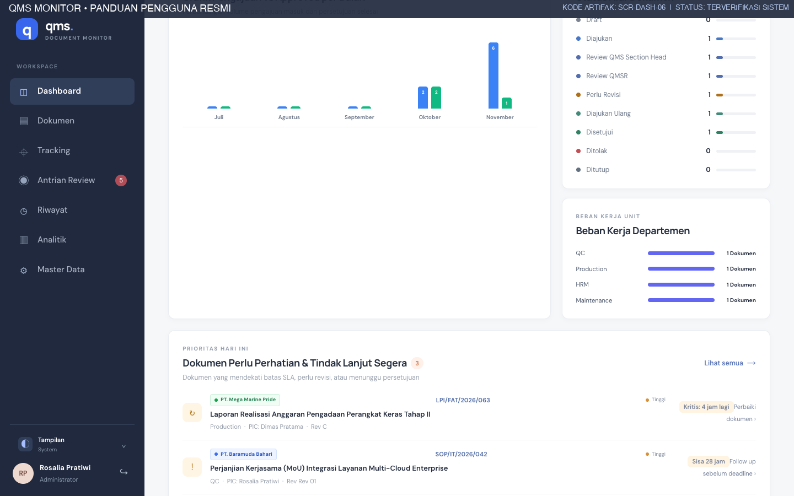
*Gambar 2.4: Distribusi Status Dokumen dan Beban Kerja per Unit Kerja (SCR-DASH-06).*

---

## 3. PENGELOLAAN DATA MASTER WORKSPACE

Menu Master Data (`/master-data`) adalah hak akses eksklusif Administrator untuk menjaga konsistensi parameter operasional sistem.

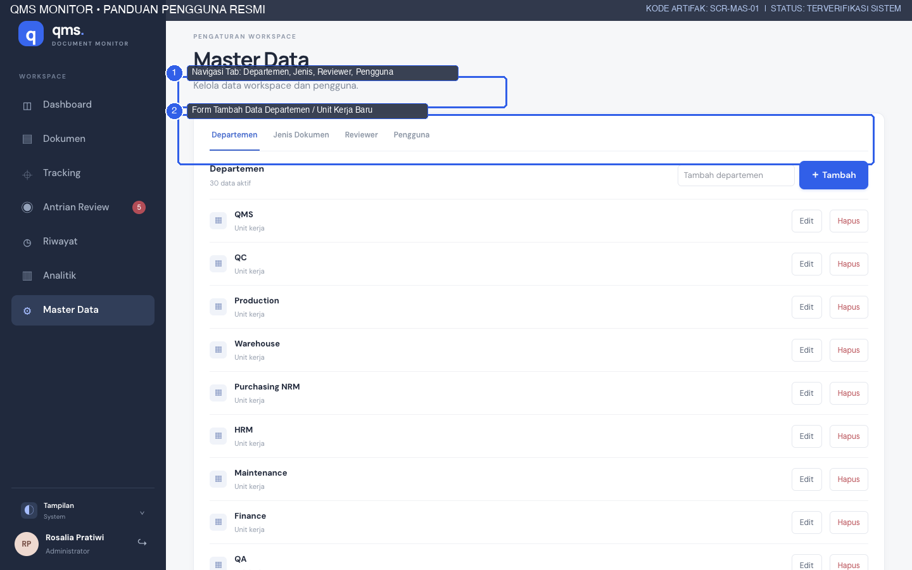
*Gambar 3.1: Halaman Konfigurasi Master Data Workspace (SCR-MAS-01) dengan Bilah Tab Navigasi ① dan Formulir Tambah Data ②.*

### 3.1 Mengelola Departemen (Unit Kerja)
Daftar departemen menentukan unit pemilik dokumen dalam alur pengajuan.
- **Menambah Departemen Baru:**
  1. Klik tab **Departemen**.
  2. Pada kolom isian `Tambah departemen`, ketik nama unit kerja baru (contoh: `Laboratorium Mikrobiologi`, `Maintenance Cold Storage`).
  3. Klik tombol **＋ Tambah**. Sistem akan menyimpan data dan merefresh daftar unit kerja.
- **Mengubah Nama Departemen:**
  1. Klik tombol **Edit** pada baris departemen yang bersangkutan.
  2. Perbaiki nama unit kerja pada kotak teks, lalu klik **Simpan**.
- **Menghapus / Menonaktifkan Departemen:**
  1. Klik tombol **Hapus** pada baris departemen. Departemen akan dinonaktifkan secara aman (*soft delete*) sehingga dokumen historis yang telah terbit sebelumnya tidak kehilangan relasi data.

### 3.2 Mengelola Jenis Dokumen & Standar SLA
Jenis dokumen menentukan hierarki dokumen mutu dan batasan hari kerja awal sebelum penyesuaian prioritas.

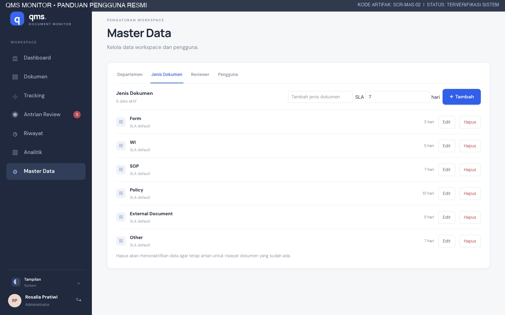
*Gambar 3.2: Tab Jenis Dokumen & Konfigurasi Standar Hari Kerja SLA (SCR-MAS-02).*

| Jenis Dokumen Mutu | SLA Standar Default | Contoh Penggunaan |
|---|---|---|
| **SOP (Standard Operating Procedure)** | 7 Hari Kerja | Prosedur operasional pengolahan udang dan ikan beku standar ekspor. |
| **WI (Work Instruction / IK)** | 5 Hari Kerja | Petunjuk kerja teknis pengoperasian mesin blast freezer. |
| **Form (Formulir Mutu)** | 3 Hari Kerja | Lembar periksa sanitasi harian dan pengujian suhu produk. |
| **Policy (Kebijakan Mutu)** | 10 Hari Kerja | Kebijakan ketertelusuran produk (*traceability*) dan kebijakan mutu korporat. |
| **Manual (Pedoman Mutu)** | 14 Hari Kerja | Manual Mutu Utama ISO 9001 / BRCGS. |
| **Spesifikasi (Spec)** | 7 Hari Kerja | Kriteria ukuran, batas mikrobiologi, dan toleransi cacat produk. |

- **Mengubah SLA Jenis Dokumen:**
  1. Buka tab **Jenis Dokumen**.
  2. Klik tombol **Edit** pada kategori yang ingin diubah.
  3. Sesuaikan target hari kerja pada kolom `SLA [ ] hari` (misal mengubah SOP dari 7 menjadi 5 hari kerja).
  4. Klik **Simpan**. Perubahan SLA hanya berlaku untuk pengajuan baru berikutnya dan tidak mengubah deadline dokumen yang sedang berjalan.

### 3.3 Mengelola Personil Reviewer Mutu
Sistem mensyaratkan personil yang ditugaskan sebagai reviewer terdaftar secara eksplisit pada tabel reviewer aktif.

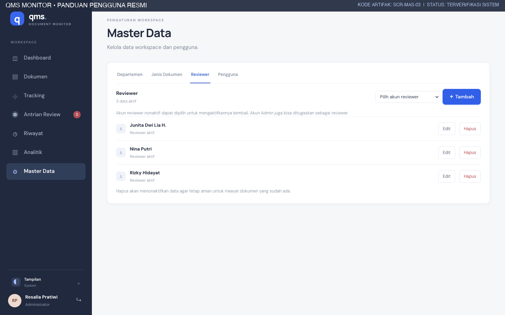
*Gambar 3.3: Tab Manajemen Reviewer Mutu Aktif (SCR-MAS-03).*

- **Menambahkan Reviewer Baru:**
  1. Buka tab **Reviewer**.
  2. Pada dropdown `Pilih akun reviewer`, pilih personil yang telah memiliki akun sistem.
  3. Klik tombol **＋ Tambah**. Nama personil akan otomatis muncul pada dropdown pilihan reviewer formulir pengajuan `/new`.
- **Menonaktifkan Reviewer:**
  1. Klik tombol **Nonaktifkan** pada nama reviewer yang cuti atau mutasi tugas. Akun tersebut tidak lagi dapat dipilih pada pengajuan baru, namun riwayat review terdahulu tetap terjaga utuh.

---

## 4. MANAJEMEN AKUN PENGGUNA & PENUGASAN PERAN

Administrator memiliki wewenang penuh dalam siklus hidup akun pengguna (*User Lifecycle Management*).

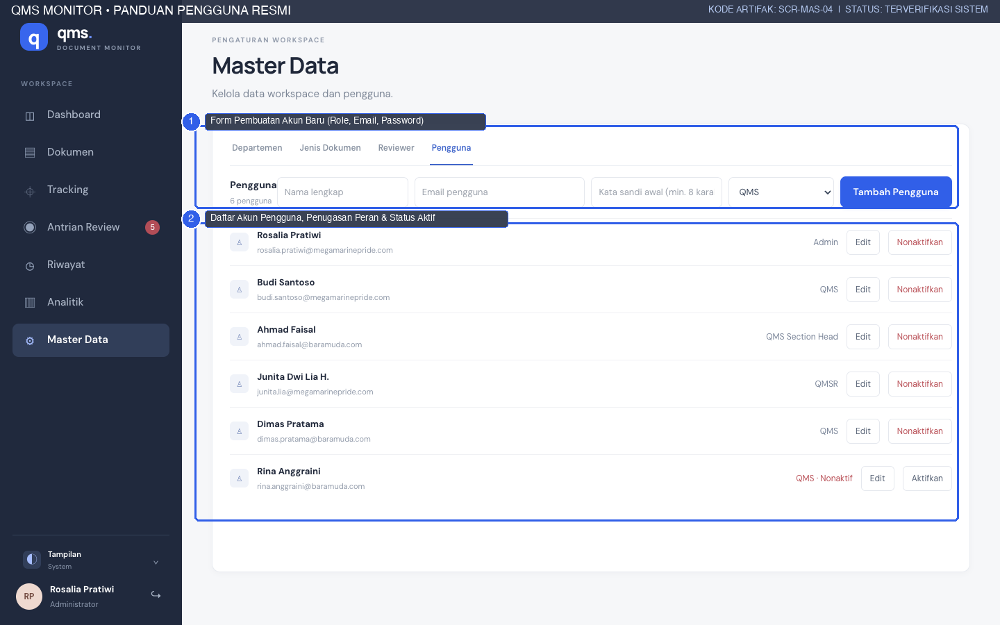
*Gambar 4.1: Tab Pengelolaan Pengguna (SCR-MAS-04) dengan Formulir Pembuatan Akun Baru ① dan Tabel Daftar Personil ②.*

### 4.1 Menambahkan Pengguna Baru
Untuk membuat akun personil baru di lingkungan perusahaan:
1. Masuk ke tab **Pengguna** pada halaman Master Data.
2. Lengkapi formulir pendaftaran:
   - **Nama Lengkap:** Masukkan nama resmi personil beserta gelar bila diperlukan (contoh: `Praditya Nugraha, S.T.`).
   - **Email Perusahaan:** Alamat email resmi domain perusahaan (contoh: `praditya.nugraha@baramuda.com`).
   - **Kata Sandi Awal:** Minimal 8 karakter (maksimal 72 karakter). Buat kombinasi huruf, angka, dan karakter khusus yang aman.
   - **Role Akun:** Pilih peran yang sesuai dengan wewenang organisasi:
     - `Admin`: Administrator dengan akses sistem penuh.
     - `QMS`: Personil pengaju dokumen (Submitter).
     - `QMS Section Head`: Kepala seksi penelaah format dan kepatuhan awal.
     - `QMSR`: Wakil manajemen mutu pengesah akhir dokumen.
3. Klik tombol **Tambah Pengguna**.

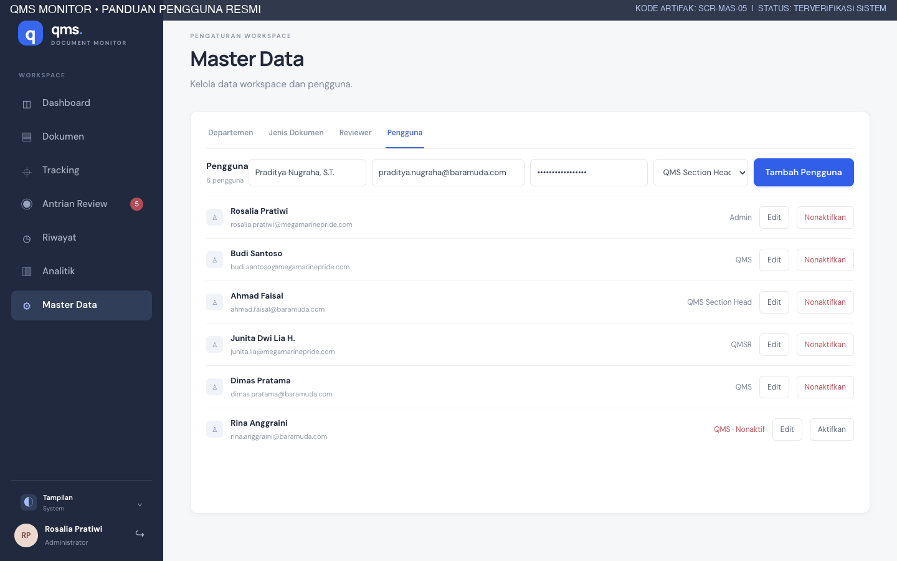
*Gambar 4.2: Pengisian Formulir Akun Pengguna Baru (SCR-MAS-05).*

### 4.2 Mengubah Peran Pengguna (Role Assignment)
Jika terdapat rotasi jabatan atau perubahan tanggung jawab:
1. Temukan baris nama pengguna pada tabel personil.
2. Klik tombol **Edit**. Baris akan berubah menjadi formulir interaktif.
3. Pada dropdown peran, pilih peran baru pengguna.
4. Klik tombol **Simpan**. Hak akses pengguna akan langsung disesuaikan pada sesi berikutnya.

*Gambar 4.3: Mode Edit Peran Akun Pengguna dan Status Aktivasi (SCR-MAS-06).*

### 4.3 Menonaktifkan Akun (Deactivation)
Jika seorang karyawan telah menyelesaikan masa kerja atau dinonaktifkan:
1. Klik tombol **Nonaktifkan** pada baris akun yang bersangkutan.
2. Label status akan berubah menjadi **Nonaktif** berwarna abu-abu.
3. Pengguna tersebut tidak lagi dapat login ke sistem. Jika diperlukan di masa mendatang, klik **Aktifkan** untuk memulihkan hak akses tanpa kehilangan riwayat kerja sebelumnya.

---

## 5. REPOSITORI DOKUMEN MUTU & PENGAWASAN ALUR

Halaman Dokumen (`/documents`) menyediakan tabel terpadu seluruh dokumen mutu kedua perusahaan.

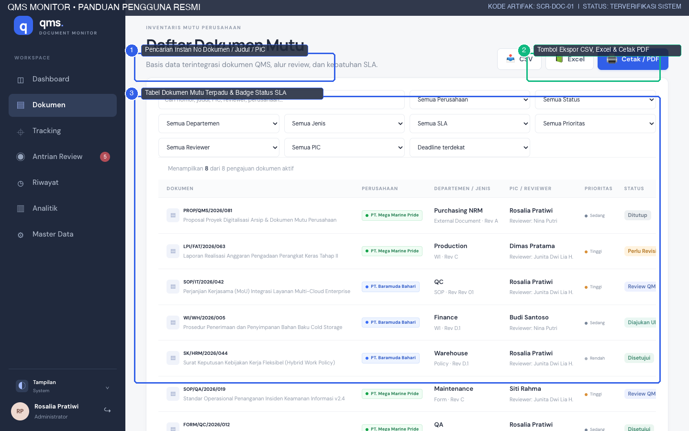
*Gambar 5.1: Gudang Repositori Dokumen Mutu Terpadu (SCR-DOC-01) dilengkapi Filter Pencarian ①, Tombol Ekspor ②, dan Tabel Status Alur ③.*

### 5.1 Filter Pencarian & Penyaringan Multi-Facet
Administrator dapat menyaring data berdasarkan kombinasi kriteria:
- **Pencarian Kata Kunci:** Ketikkan nomor dokumen, judul, nama PIC, atau departemen pada kotak pencarian teks.
- **Penyaringan Status:** Menyaring dokumen berdasarkan status alur tertentu (`Diajukan`, `Sedang Direview`, `Perlu Revisi`, `Review QMSR`, `Disetujui`, `Ditutup`).
- **Penyaringan SLA:** Menampilkan dokumen yang `Tepat Waktu`, `Mendekati Batas SLA`, atau `Terlambat (Overdue)`.

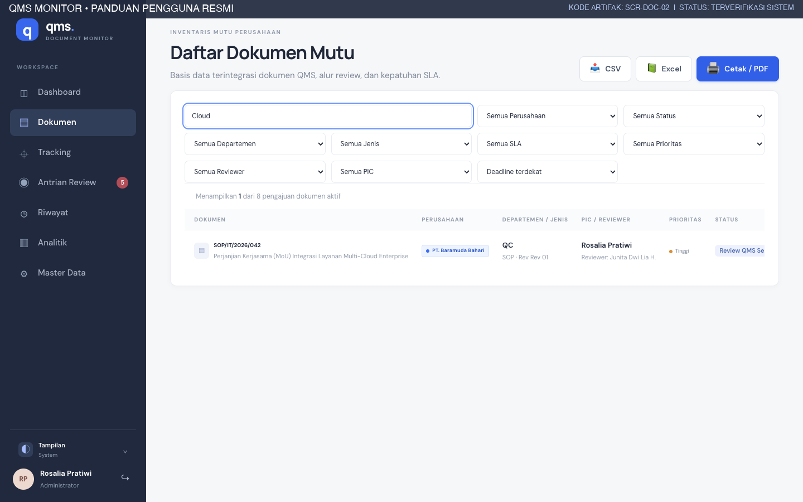
*Gambar 5.2: Interaksi Filter Pencarian Instan Dokumen Mutu (SCR-DOC-02).*

### 5.2 Ekspor Data: CSV, Excel (.xlsx), dan Cetak / PDF
QMS Monitor mendukung 3 (tiga) kanal ekspor data resmi untuk pelaporan internal dan kebutuhan audit eksternal:

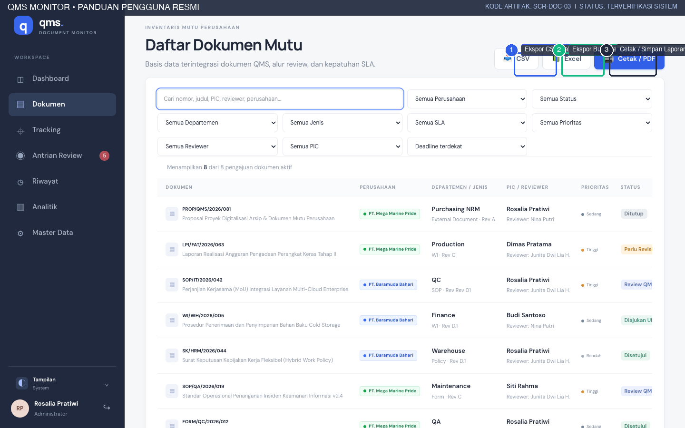
*Gambar 5.3: Kelompok Tombol Ekspor Data Dokumen Mutu (SCR-DOC-03).*

1. **Tombol CSV (`📥 CSV`):**
   - Menghasilkan file teks `qms-documents-export-[tanggal].csv` berformat *comma-separated values* berstandar UTF-8.
   - Berisi seluruh kolom teknis: Nomor Registrasi Sistem, Perusahaan, Departemen, Jenis, Nomor Dokumen, Revisi, Judul, Prioritas, Tanggal Pengajuan, Target Hari SLA, Batas Deadline, Status Alur, PIC, dan Nama Reviewer.
2. **Tombol Excel (`📗 Excel`):**
   - Menghasilkan buku kerja spreadsheet `qms-documents-export-[tanggal].xlsx`.
   - Menggunakan library SheetJS dengan format sel terstruktur, auto-width kolom, dan heading tebal (*bold*) yang siap dianalisis menggunakan pivot table atau rumus lanjutan.
3. **Tombol Cetak / PDF (`🖨️ Cetak / PDF`):**
   - Membuka dialog pratinjau cetak browser resmi (*Native Print Engine*).
   - Seluruh elemen navigasi sidebar dan tombol aksi otomatis disembunyikan melalui aturan CSS `@media print`.
   - Menghasilkan dokumen cetak bersih yang siap disimpan sebagai file PDF (*Save as PDF*) atau dicetak pada kertas A4 Landscape.

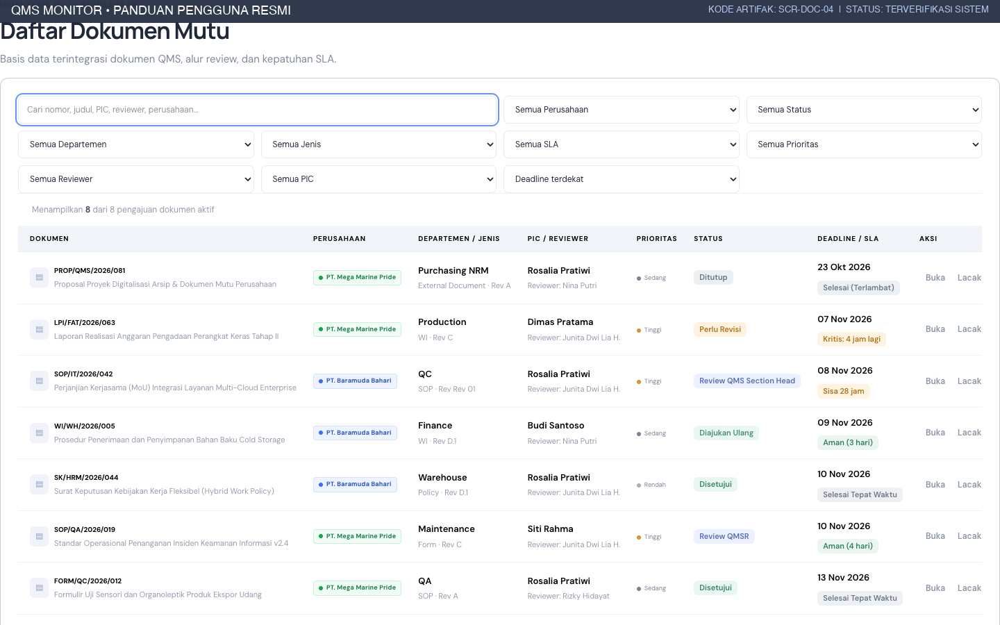
*Gambar 5.4: Tampilan Pratinjau Layout Cetak / PDF Dokumen Mutu (SCR-DOC-04).*

### 5.3 Kebijakan Penghapusan & Pengarsipan Dokumen
Pada baris tabel dokumen, Administrator memiliki tombol **Hapus**:
- Tindakan ini berfungsi sebagai pengarsipan dokumen (*soft archive*) untuk dokumen uji coba atau pengajuan yang dibatalkan atas persetujuan pimpinan.
- Sistem akan meminta konfirmasi browser sebelum tindakan dijalankan.
- Dokumen yang telah disetujui resmi dan memiliki nomor distribusi tidak boleh dihapus demi menjaga integritas kepatuhan audit sistem mutu ISO 9001.

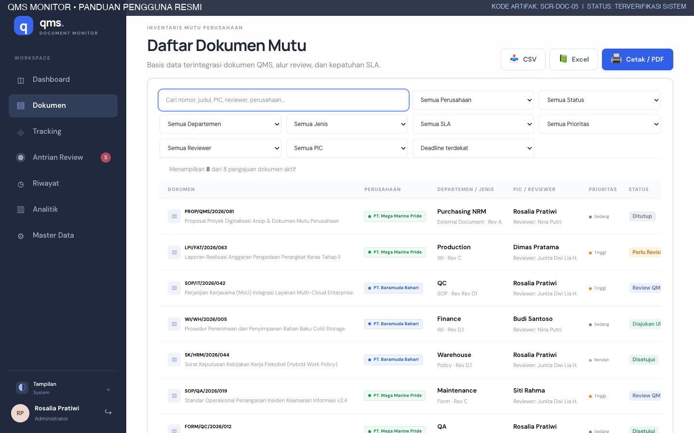
*Gambar 5.5: Tombol Hapus Dokumen Khusus Administrator (SCR-DOC-05).*

---

## 6. AUDIT TRAIL GLOBAL & HISTORI SISTEM

Menu Riwayat (`/history`) mencatat setiap aksi yang terjadi di seluruh sistem:
- Setiap perubahan status mencatat: **Waktu Kejadian (WIB)**, **Nama Aktor**, **Peran Akun**, **Nomor Dokumen**, **Aksi yang Dijalankan**, dan **Catatan / Alasan Perubahan**.
- Data riwayat audit bersifat permanen (*append-only*) dan tidak dapat dimanipulasi melalui antarmuka pengguna.
- Administrator dapat menyaring riwayat berdasarkan nama personil atau nomor dokumen tertentu untuk merekonstruksi kronologi persetujuan dokumen saat pelaksanaan audit internal maupun sertifikasi BRCGS/HACCP.

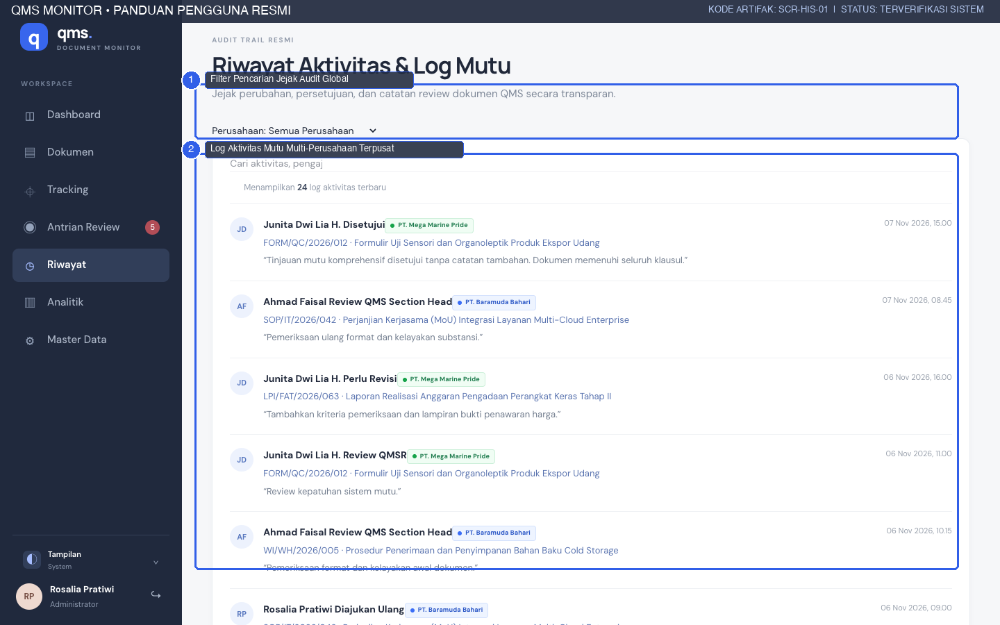
*Gambar 6.1: Jejak Audit Trail Kronologis Terpusat (SCR-HIS-01).*

---

## 7. ANALITIK TINGKAT KEPATUHAN & PREDIKSI BOTTLENECK

Menu Analitik (`/analytics`) menyediakan laporan grafis mendalam mengenai:
1. **Tren Kepatuhan SLA Kumulatif:** Mengukur tren ketepatan waktu penyelesaian dokumen dari bulan ke bulan.
2. **Perbandingan Volume Antar Entitas:** Mengetahui perbandingan aktivitas penerbitan dokumen antara PT. Mega Marine Pride dan PT. Baramuda Bahari.
3. **Analisis Hambatan (Bottleneck Detection):** Mengidentifikasi tahapan alur yang paling sering memicu keterlambatan (apakah pada tahap verifikasi format Section Head atau evaluasi teknis QMSR) sehingga manajemen mutu dapat mengambil tindakan preventif yang tepat.

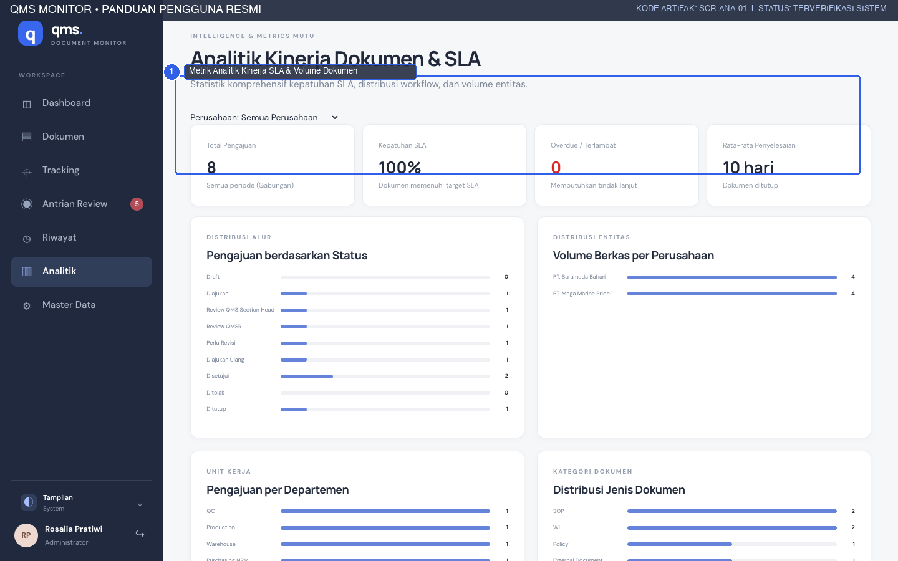
*Gambar 7.1: Halaman Analitik Metrik Mutu & Kepatuhan SLA (SCR-ANA-01).*

---

## 8. PROSEDUR OPERASIONAL RUTIN ADMINISTRATOR

Untuk menjaga kinerja sistem tetap optimal, Administrator disarankan menjalankan rutinitas berikut:
- **Harian (08:30 WIB):** Memeriksa dasbor utama untuk melihat dokumen yang berstatus *SLA Terkritis / Mendekati Batas*, serta berkoordinasi dengan reviewer terkait jika terdapat dokumen mendesak.
- **Mingguan (Jumat Sore):** Melakukan ekspor data Excel (.xlsx) untuk arsip cadangan mingguan di folder jaringan terproteksi perusahaan.
- **Bulanan (Awal Bulan):** Mengaudit akun pengguna untuk memastikan seluruh karyawan mutasi atau nonaktif telah diperbarui hak aksesnya.

