# PANDUAN PENGGUNA PENGAJU DOKUMEN (QMS SUBMITTER)
## QMS MONITOR — MODUL PENGAJUAN, REVISI & PENUTUPAN SIKLUS MUTU
**PT. MEGA MARINE PRIDE & PT. BARAMUDA BAHARI**

---

| Informasi Dokumen | Detail |
|---|---|
| **Kode Dokumen** | `QMS-MMP-SUB-003` |
| **Versi Dokumen** | 1.0 (Edisi Produksi) |
| **Tanggal Efektif** | 7 November 2026 |
| **Sasaran Pengguna** | Tim QMS, Staff Pengendali Dokumen, Requestor Mutu |
| **Penyusun** | Technical Documentation & Business Analyst Team |
| **Penelaah** | Rosalia Pratiwi |
| **Klasifikasi Akses** | Internal Enterprise Restricted |

---

## 1. PENGENALAN PERAN PENGAJU DOKUMEN (QMS SUBMITTER)

Sebagai **QMS Submitter**, Anda memegang peranan krusial sebagai garda terdepan sistem manajemen mutu perusahaan. Tugas utama Anda meliputi:
1. Menerima draf naskah dokumen dari unit kerja (*departemen pemilik*) baik di **PT. Mega Marine Pride** maupun **PT. Baramuda Bahari**.
2. Melakukan registrasi dokumen ke dalam sistem QMS Monitor dengan metadata lengkap, pemilihan entitas yang tepat, dan lampiran berkas resmi.
3. Menentukan skala prioritas dan menugaskan Reviewer QMSR yang berkompeten.
4. Memantau progres penelaahan melalui fitur Tracking dan Antrian Tugas personal.
5. Merespons permintaan perbaikan (*revision feedback*) secara cepat sebelum batas tenggat waktu SLA berakhir.
6. Menutup siklus dokumen (*closed*) setelah pengesahan resmi diterbitkan oleh QMSR guna mendistribusikan salinan terkendali kepada personil operasional.

### 1.1 Tampilan Dasbor Khusus Pengaju (Fokus Pengaju)
Saat login menggunakan peran QMS Submitter, halaman utama otomatis menampilkan dasbor terpersonalisasi yang berfokus pada dokumen yang Anda ajukan:

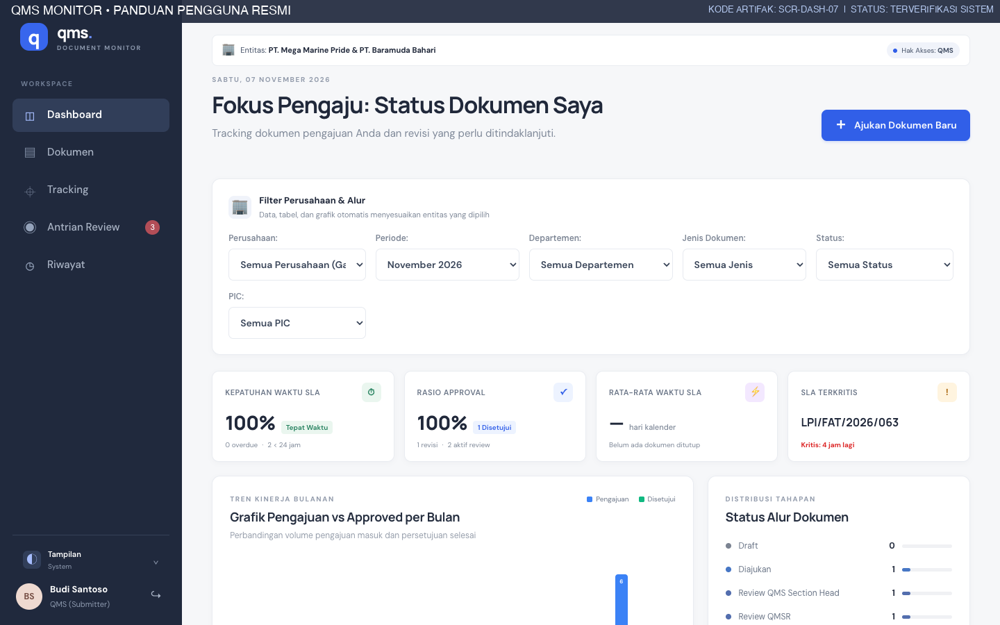
*Gambar 1.1: Dasbor Fokus Pengaju QMS Submitter (SCR-DASH-07).*

Dasbor ini menampilkan:
- Jumlah dokumen aktif yang sedang berada dalam antrian penelaahan.
- Dokumen yang berstatus **Perlu Revisi** dan membutuhkan tindakan segera dari Anda.
- Dokumen yang telah **Disetujui** dan siap untuk dilakukan penutupan/distribusi.

---

## 2. PROSEDUR PENGAJUAN DOKUMEN BARU (`/new`)

Untuk memulai pengajuan dokumen baru, klik tombol **＋ Ajukan Dokumen** pada header atas atau navigasikan ke menu `/new`.

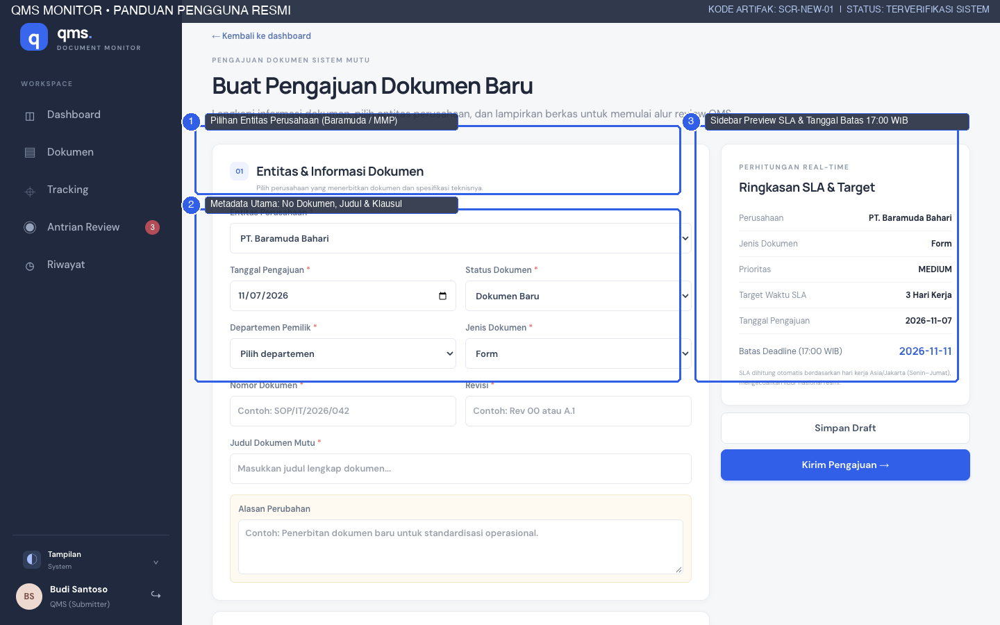
*Gambar 2.1: Formulir Pengajuan Dokumen Mutu Baru (SCR-NEW-01) menampilkan Pilihan Entitas ①, Metadata Utama ②, dan Sidebar Kalkulasi SLA ③.*

### 2.1 Bagian 01: Entitas & Informasi Dokumen

#### A. Entitas Perusahaan (*Wajib*)
Pilih badan usaha yang secara sah menerbitkan dokumen mutu tersebut:
- **PT. Mega Marine Pride:** Fasilitas pengolahan hasil laut terpadu.
- **PT. Baramuda Bahari:** Unit industri perikanan dan rantai pasok maritim.
> *Catatan:* Pemilihan entitas ini akan menentukan penomoran sistem, isolasi data, serta kop dokumen resmi saat dicetak.

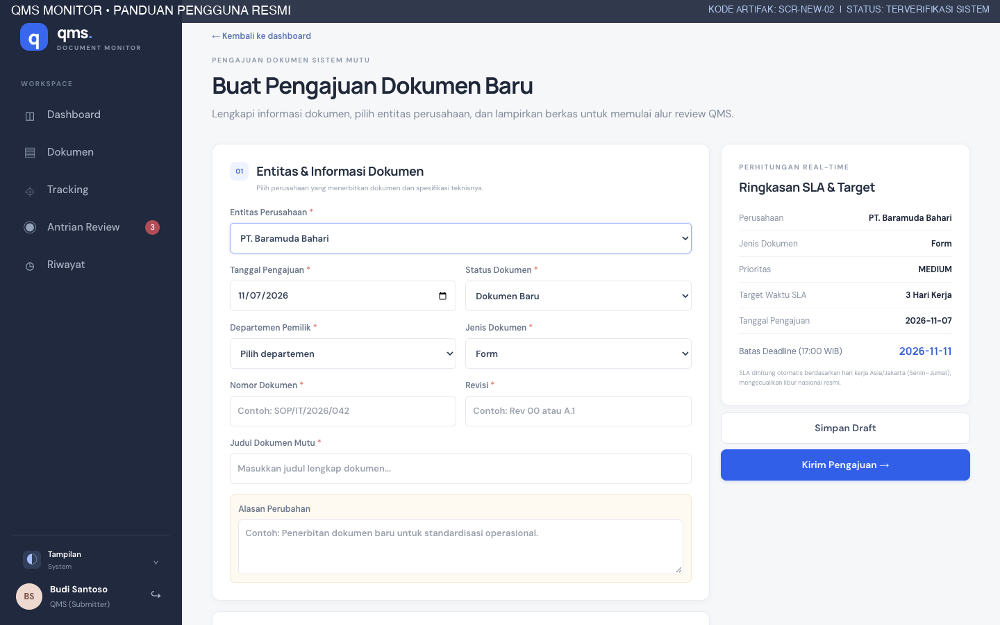
*Gambar 2.2: Pemilihan Entitas Perusahaan pada Formulir Pengajuan (SCR-NEW-02).*

#### B. Status Dokumen (Kondisi Baru vs Lama)
- **Dokumen Baru:** Diterbitkan pertama kali, belum pernah memiliki riwayat registrasi dalam sistem QMS sebelumnya.
- **Dokumen Lama (Revisi/Pembaruan):** Pembaruan, amandemen, atau kaji ulang berkala terhadap dokumen yang telah berlaku.
  - Saat memilih **Dokumen Lama**, sistem akan memunculkan kolom wajib baru: **Alasan Perubahan**.
  - Pengaju wajib menjelaskan latar belakang revisi (misal: *“Penyesuaian batas kritis suhu pembekuan sesuai audit BRCGS Issue 9 klausul 5.3”*).

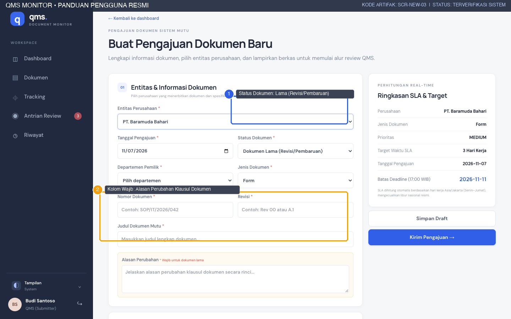
*Gambar 2.3: Pemilihan Kondisi Dokumen Lama dan Isian Wajib Alasan Perubahan (SCR-NEW-03).*

#### C. Pengisian Metadata Teknis Dokumen
Isi seluruh kolom metadata dengan cermat sesuai draf fisik:
1. **Tanggal Pengajuan:** Tanggal dokumen didaftarkan (otomatis terisi tanggal hari ini dalam format `YYYY-MM-DD`).
2. **Departemen Pemilik:** Pilih unit kerja yang menerbitkan naskah (contoh: *Quality Assurance, Production, HSE, Purchasing RM*).
3. **Jenis Dokumen:** Pilih kategori naskah mutu (*SOP, Work Instruction, Form, Policy, Manual, Spesifikasi*). Pemilihan ini akan menentukan target hari kerja dasar SLA.
4. **Nomor Dokumen:** Nomor formal dokumen mutu perusahaan (contoh: `SOP/QA/2026/088` atau `IK/PROD/2026/012`).
5. **Revisi:** Nomor atau kode revisi dokumen (contoh: `Rev 00`, `Rev 01`, atau `Rev 02.1`).
6. **Judul Dokumen Mutu:** Tulis judul lengkap dengan huruf kapital yang rapi (contoh: *“SOP Pengendalian Dokumen Mutu Terpadu”*).

*Gambar 2.4: Metadata Dokumen Terisi Lengkap pada Formulir Pengajuan (SCR-NEW-04).*

### 2.2 Bagian 02: Penanggung Jawab, Reviewer & Lampiran

#### A. Penugasan Reviewer QMSR & Skala Prioritas
- **Nama PIC / Requestor:** Masukkan nama personil penyusun atau perwakilan departemen pemilik (contoh: *Rosalia Pratiwi*).
- **Reviewer QMSR Ditugaskan (*Wajib*):** Pilih personil QMSR yang memiliki sertifikasi penelaahan untuk jenis dokumen tersebut (contoh: *Junita Dwi Lia H.*).
- **Prioritas Dokumen:**
  - **Rendah (Low):** Dokumen tinjauan rutin non-kritis (SLA +1 hari).
  - **Normal (Medium):** Pengajuan operasional standar perusahaan.
  - **Tinggi (High):** Dokumen pemenuhan audit mendesak (SLA -1 hari).
  - **Kritis (Critical):** Dokumen pencegahan penahanan ekspor atau temuan ketidaksesuaian mayor (Target: 1 hari kerja).

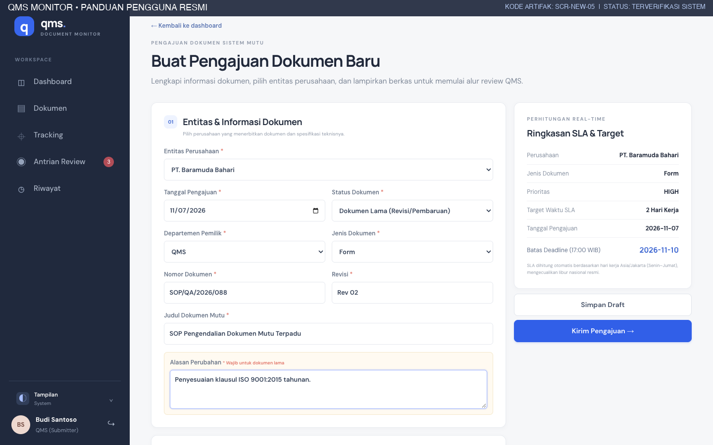
*Gambar 2.5: Penugasan Reviewer QMSR dan Pengaturan Prioritas Dokumen (SCR-NEW-05).*

#### B. Unggah Berkas Lampiran (File Attachment)
1. Unggah berkas draf dokumen dalam format yang didukung: **PDF (.pdf)**, **Word (.doc, .docx)**, atau **Excel (.xls, .xlsx)**.
2. Batas ukuran berkas maksimal adalah **10 MB per file**.
3. Pastikan berkas draf menyertakan tabel riwayat revisi dan paraf awal dari kepala bagian departemen pemilik.

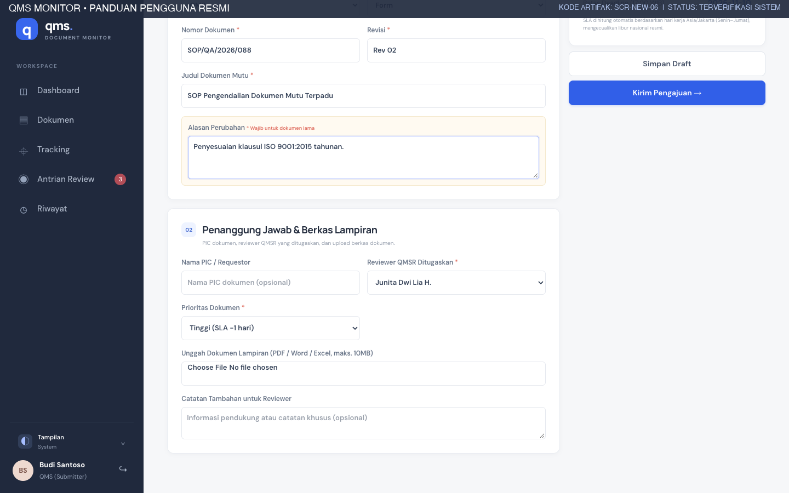
*Gambar 2.6: Area Unggah Berkas Lampiran Draf Dokumen Mutu (SCR-NEW-06).*

### 2.3 Memeriksa Perhitungan Real-Time SLA Sidebar
Sebelum mengirimkan pengajuan, periksa panel ringkasan di sisi kanan layar:
- Menampilkan entitas perusahaan, kategori, dan skala prioritas.
- Menghitung **Target Waktu SLA** secara otomatis dalam satuan hari kerja kalender Jakarta (Senin–Jumat, mengabaikan libur nasional).
- Menampilkan estimasi **Batas Deadline** resmi tepat pukul **17:00 WIB**.

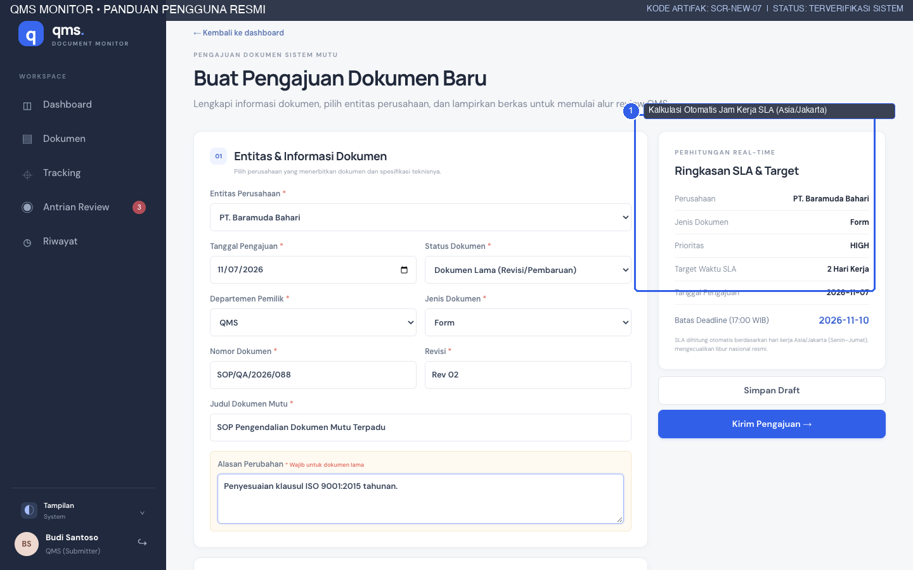
*Gambar 2.7: Sidebar Pratinjau Perhitungan SLA dan Tanggal Jatuh Tempo (SCR-NEW-07).*

### 2.4 Opsi Penyimpanan: Simpan Draft vs Kirim Pengajuan
Pada bagian bawah formulir terdapat 2 (dua) opsi tindakan:
1. **Simpan Draft:** Menyimpan isian data sementara ke dalam sistem tanpa memicu alur review dan tanpa memulai hitungan SLA. Dokumen draf dapat Anda edit kembali kapan saja.
2. **Kirim Pengajuan →:** Memvalidasi seluruh field wajib, mengunci status menjadi `Diajukan (submitted)`, mencatat log audit awal, dan memasukkan berkas ke dalam antrian kerja Section Head.

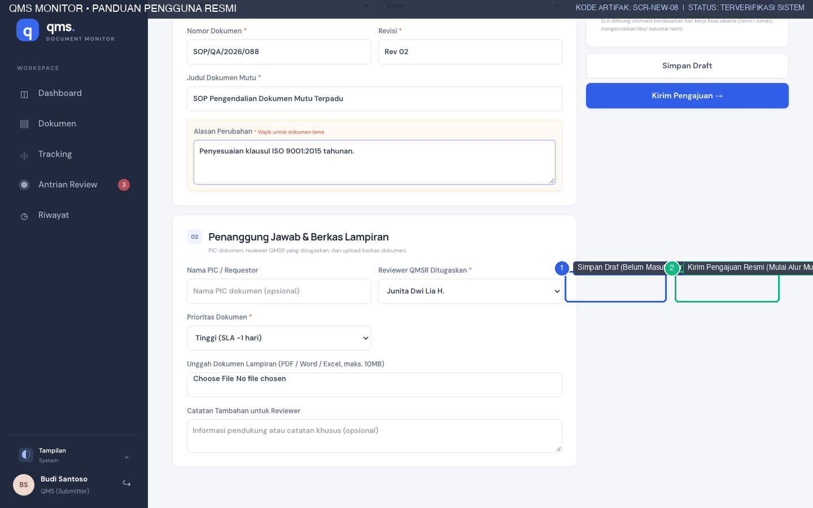
*Gambar 2.8: Tombol Aksi Simpan Draft dan Kirim Pengajuan (SCR-NEW-08).*

### 2.5 Penanganan Peringatan Validasi Formulir
Jika Anda menekan tombol *Kirim Pengajuan* namun terdapat kolom wajib yang belum diisi (misal alasan perubahan untuk dokumen lama belum terisi atau reviewer belum dipilih), sistem akan memunculkan banner peringatan merah di bagian atas formulir:

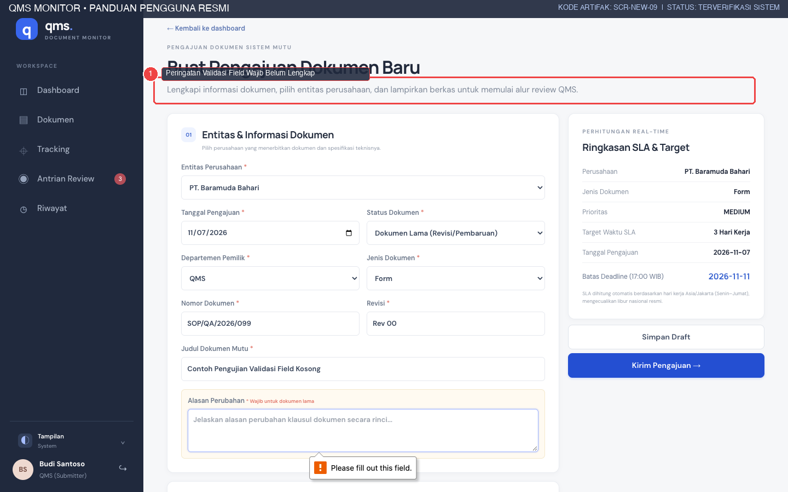
*Gambar 2.9: Peringatan Validasi Sistem jika Field Wajib Belum Lengkap (SCR-NEW-09).*

---

## 3. MEMANTAU PROGRES DOKUMEN DALAM SISTEM

### 3.1 Antrian Tugas Pengaju (`/actions`)
Buka menu **Antrian Review** (`/actions`) untuk melihat kelompok dokumen Anda:
- **Perlu Revisi & Perbaikan Klausa:** Dokumen yang dikembalikan oleh Section Head atau QMSR untuk Anda perbaiki.
- **Telah Disetujui (Menunggu Penutupan):** Dokumen yang telah disahkan dan menanti proses penutupan resmi.
- **Pengajuan Terlambat:** Dokumen yang telah melampaui batas SLA.

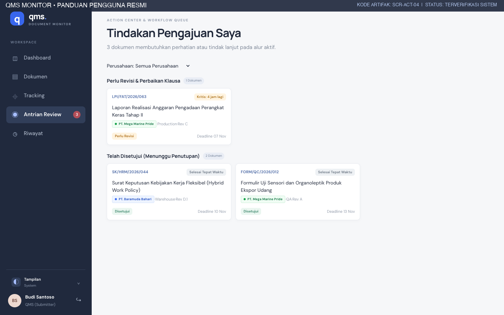
*Gambar 3.1: Antrian Kerja Personal Pengaju Dokumen (SCR-ACT-04).*

### 3.2 Halaman Rincian Dokumen (`/documents/[id]`)
Klik judul dokumen dari tabel atau antrian untuk membuka halaman rincian menyeluruh:
- **Panel Metadata:** Nomor registrasi sistem, perusahaan, departemen, jenis, revisi, dan nama PIC.
- **Tautan Berkas:** Akses untuk mengunduh lampiran naskah asli.
- **Tautan Pelacakan:** Tombol langsung menuju fitur Tracking dokumen.

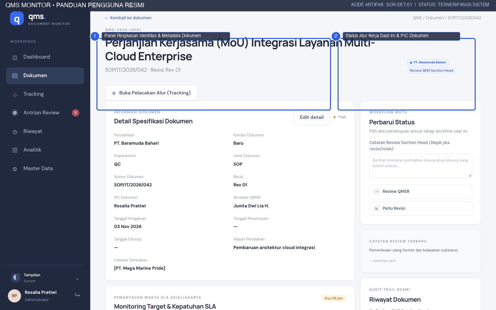
*Gambar 3.2: Halaman Rincian Dokumen Mutu Terpadu (SCR-DET-01).*

---

## 4. PROSEDUR MENANGANI REVISI & PENGAJUAN ULANG (RESUBMISSION)

Jika reviewer menemukan ketidaksesuaian klausul atau format dokumen:
1. Status dokumen akan berubah menjadi kuning: **Perlu Revisi (`need_revision`)**.
2. Spanduk kuning akan muncul di halaman rincian dokumen dengan kutipan catatan reviewer.

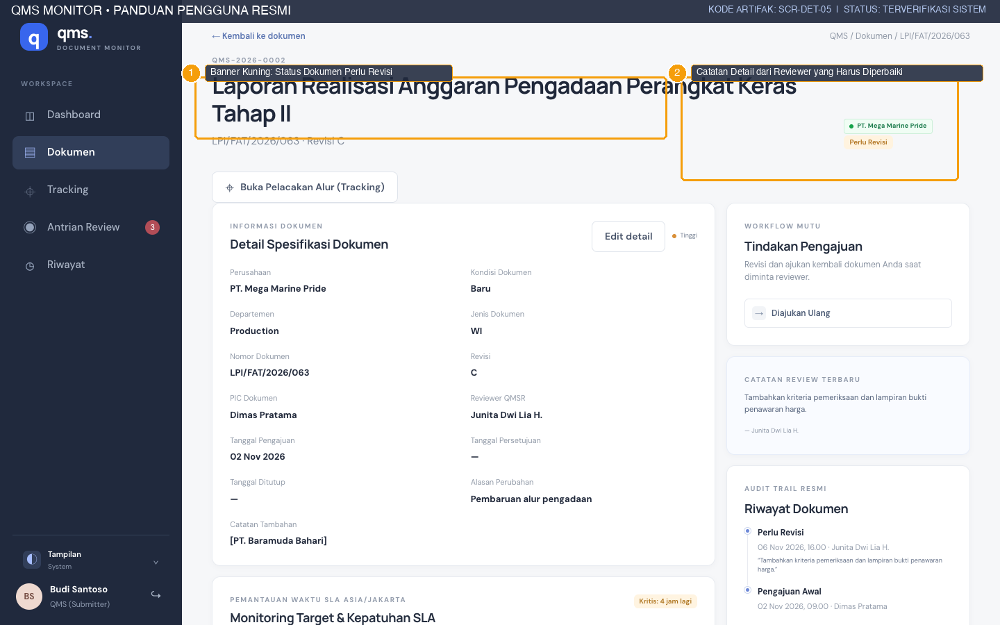
*Gambar 4.1: Spanduk Peringatan Dokumen Perlu Revisi dan Catatan Masukan Reviewer (SCR-DET-05).*

### 4.1 Langkah-Langkah Melakukan Perbaikan:
- **Langkah 1: Baca Catatan Reviewer.** Perhatikan klausul spesifik yang diminta diperbaiki (contoh: *“Terdapat ketidaksesuaian penomoran sub-alur 3.2 pada bab mitigasi SLA dan margin tabel”*).
- **Langkah 2: Ubah Metadata Dokumen (Jika Diperlukan).** Klik tombol **Ubah Data** untuk memperbarui judul, revisi, atau alasan perubahan.
- **Langkah 3: Unggah Berkas Draf Hasil Perbaikan.** Pada panel lampiran, klik tombol **Unggah Lampiran Baru** dan pilih file naskah yang telah diperbaiki.
- **Langkah 4: Kirim Pengajuan Ulang.** Masukkan catatan ringkas pada kolom konfirmasi (misal: *“Format sub-alur 3.2 telah diperbaiki sesuai arahan Section Head”*), lalu klik tombol **Diajukan Kembali (resubmitted)**.
- **Hasil yang Diharapkan:** Status dokumen otomatis berubah menjadi `resubmitted`, log audit diperbarui, dan dokumen kembali masuk ke meja pemeriksaan Section Head.

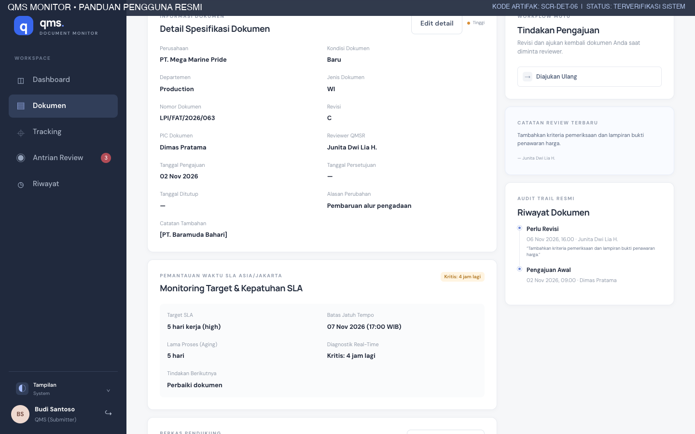
*Gambar 4.2: Panel Unggah Lampiran Perbaikan dan Tombol Ajukan Kembali (SCR-DET-06).*

---

## 5. PENGESAHAN AKHIR & PENUTUPAN SIKLUS MUTU (CLOSING)

### 5.1 Memverifikasi Dokumen Disetujui (Approved)
Ketika penelaahan final oleh QMSR selesai:
- Status dokumen berubah menjadi hijau: **Disetujui (`approved`)**.
- Tanggal persetujuan resmi terekam permanen dalam basis data sistem.

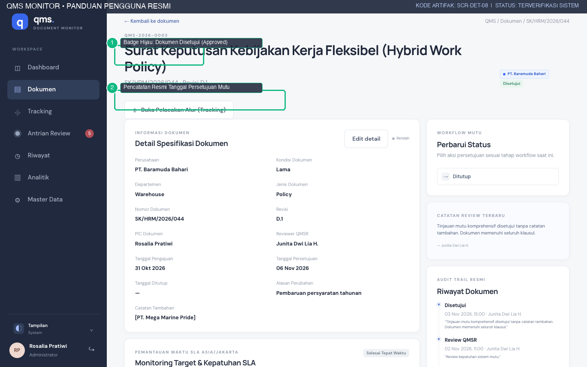
*Gambar 5.1: Status Dokumen Disetujui (Approved) dengan Tanggal Pengesahan Resmi (SCR-DET-08).*

### 5.2 Menutup Siklus Dokumen (Closed)
Setelah dokumen disetujui, tugas akhir QMS Submitter adalah mendistribusikan salinan terkendali kepada unit kerja terkait, lalu menutup dokumen di sistem:
1. Buka halaman rincian dokumen yang telah disetujui.
2. Pada panel alur kerja di sebelah kanan, klik tombol **Tutup Dokumen (Selesai)**.
3. Status berubah menjadi **Ditutup (`closed`)**. Siklus SLA resmi dihentikan dan dicatat sebagai keberhasilan tepat waktu.

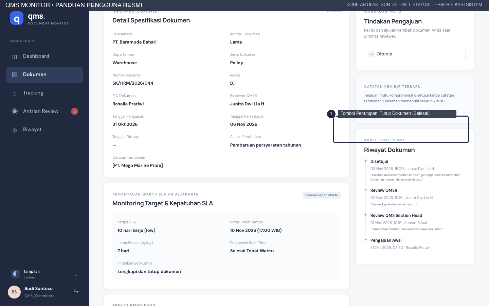
*Gambar 5.2: Tombol Penutupan Resmi Dokumen Mutu (SCR-DET-09).*

---

## 6. FITUR PELACAKAN DOKUMEN INTERAKTIF (`/tracking`)

Fitur Tracking (`/tracking`) menyediakan visualisasi 6 milestone yang dapat diakses kapan saja untuk transparansi alur mutu:
1. **Pengajuan Awal:** Tanggal pengajuan dan PIC pembuat dokumen.
2. **Review Section Head:** Tanggal verifikasi dan status persetujuan tahap 1.
3. **Revisi Pengaju:** Riwayat putaran koreksi naskah (bila ada).
4. **Review QMSR:** Evaluasi kepatuhan klausul standar tingkat perusahaan.
5. **Persetujuan Resmi:** Tanggal pengesahan tanda tangan mutu.
6. **Distribusi & Pengarsipan:** Konfirmasi dokumen telah diedarkan ke departemen operasional.

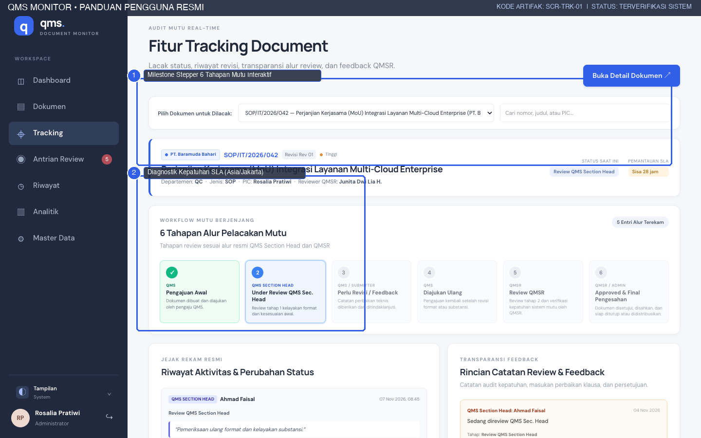
*Gambar 6.1: Visualisasi 6 Milestone Alur Mutu pada Halaman Tracking (SCR-TRK-01).*

---

## 7. CONTOH KASUS PENGAJUAN END-TO-END (WALKTHROUGH)

Berikut adalah ringkasan skenario pengajuan standar yang berhasil diselesaikan:
- **Nama Dokumen:** *SOP Pengendalian Dokumen Mutu Terpadu*
- **Entitas:** PT. Baramuda Bahari
- **Nomor Dokumen:** `SOP/QA/2026/042`
- **Revisi:** `Rev 01`
- **PIC:** Rosalia Pratiwi
- **Alur Kronologis:**
  1. *03 Nov 2026, 08:30 WIB:* Pengajuan awal dikirim oleh Rosalia Pratiwi (`submitted`).
  2. *04 Nov 2026, 10:15 WIB:* Section Head memulai pemeriksaan (`under_review`).
  3. *05 Nov 2026, 14:00 WIB:* Diberikan catatan perbaikan klausul 3.2 (`need_revision`).
  4. *06 Nov 2026, 09:00 WIB:* Pengaju mengunggah revisi berkas (`resubmitted`).
  5. *06 Nov 2026, 11:30 WIB:* Section Head menyetujui dan meneruskan ke QMSR (`qmsr_review`).
  6. *07 Nov 2026, 10:00 WIB:* QMSR menyetujui pengajuan tanpa catatan tambahan (`approved`).
  7. *07 Nov 2026, 11:00 WIB:* Pengaju melakukan penutupan siklus dan mendistribusikan salinan terkendali (`closed`).
- **Hasil Audit:** Kepatuhan SLA terpenuhi 100% dalam 4 hari kerja dari target 7 hari kerja yang ditentukan.

