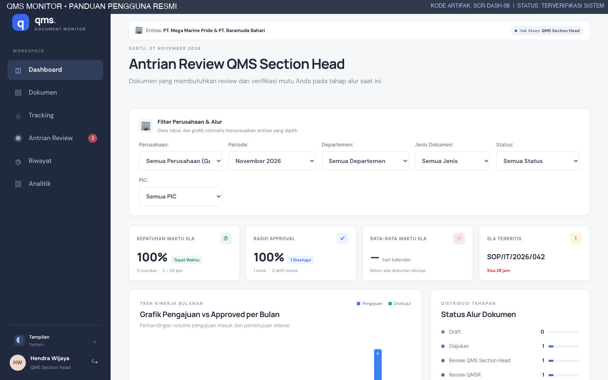
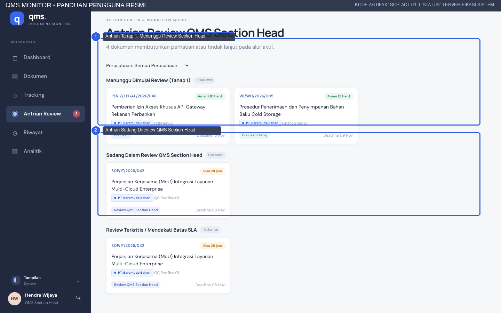
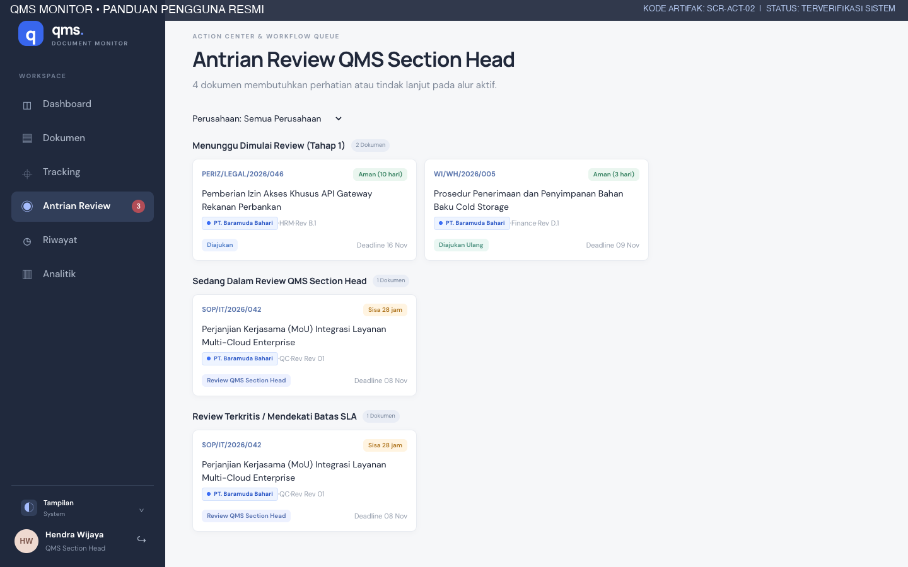
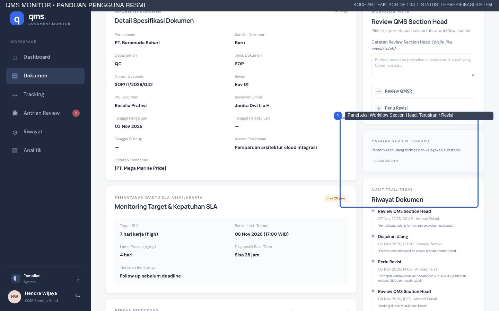
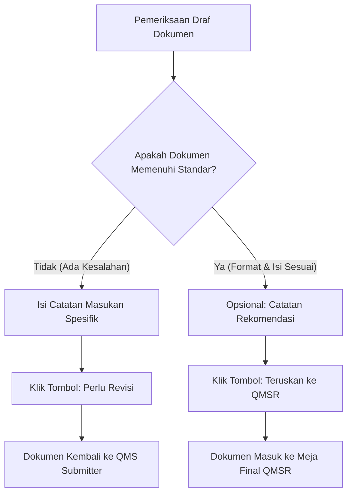
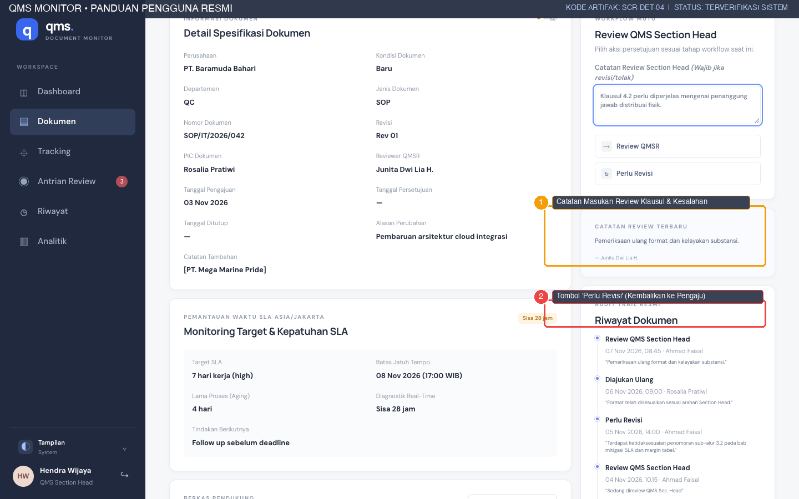
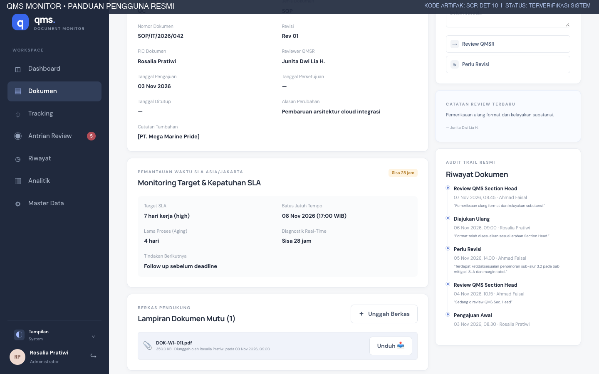
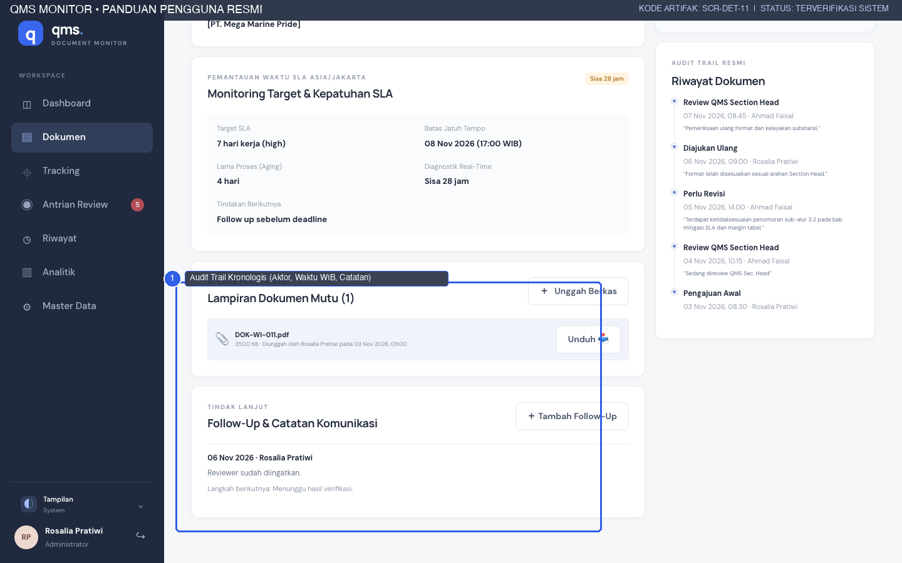
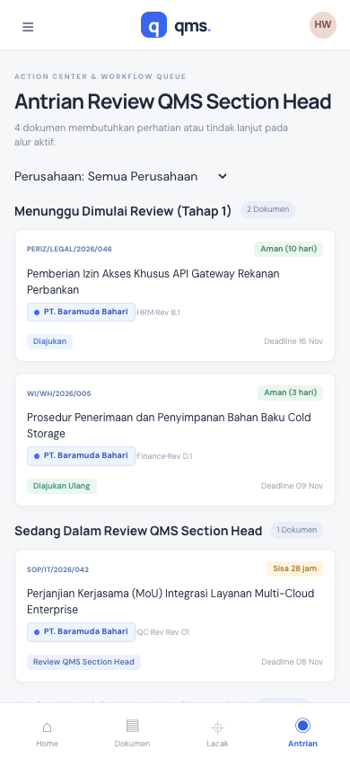

# PANDUAN PENGGUNA PENELAAH TAHAP 1 (QMS SECTION HEAD)
## QMS MONITOR — MODUL VERIFIKASI FORMAT, SUBSTANSI KLAUSUL & PENERUSAN KE QMSR
**PT. MEGA MARINE PRIDE & PT. BARAMUDA BAHARI**

---

| Informasi Dokumen | Detail |
|---|---|
| **Kode Dokumen** | `QMS-MMP-SEC-004` |
| **Versi Dokumen** | 1.0 (Edisi Produksi) |
| **Tanggal Efektif** | 7 November 2026 |
| **Sasaran Pengguna** | QMS Section Head, Kepala Seksi Kendali Mutu, Reviewer Tahap 1 |
| **Penyusun** | Technical Documentation & Quality Assurance Specialist |
| **Penelaah Mutu** | Rosalia Pratiwi |
| **Klasifikasi Akses** | Internal Enterprise Restricted |

---

## 1. PERAN & TANGGUNG JAWAB QMS SECTION HEAD

Dalam struktur tata kelola mutu di **PT. Mega Marine Pride** dan **PT. Baramuda Bahari**, **QMS Section Head** berfungsi sebagai penelaah lapis pertama (*First-Line Document Reviewer*).

Sebelum sebuah dokumen diajukan ke meja **QMSR** untuk pengesahan korporat, Section Head bertanggung jawab secara mutlak untuk memverifikasi:
1. **Kesesuaian Format & Tipografi:** Memastikan template dokumen standar perusahaan digunakan dengan benar, margin tabel rapi, penomoran halaman berurutan, dan kop surat sesuai entitas pabrik.
2. **Standardisasi Penomoran Dokumen:** Memeriksa kesesuaian kode departemen, tahun penerbitan, dan tingkatan revisi (misal: `SOP/IT/2026/042`).
3. **Ketepatan Klausul & Rujukan Mutu:** Memastikan substansi isi selaras dengan persyaratan ISO 9001:2015, standar keamanan pangan HACCP, atau ketentuan BRCGS.
4. **Pemberian Umpan Balik Korektif:** Memberikan catatan perbaikan yang jelas dan dapat ditindaklanjuti jika ditemukan ketidaksesuaian naskah.
5. **Penyaringan Efisiensi Waktu:** Memastikan dokumen yang diteruskan ke QMSR adalah dokumen yang benar-benar telah matang dan bebas kesalahan redaksional.

### 1.1 Tampilan Dasbor Khusus Section Head
Saat masuk dengan peran Section Head, dasbor menampilkan header khusus: **Antrian Review QMS Section Head**:

*Gambar 1.1: Dasbor Khusus QMS Section Head (SCR-DASH-08).*

---

## 2. PENGELOLAAN ANTRIAN REVIEW TAHAP 1 (`/actions`)

Halaman **Antrian Review** (`/actions`) adalah ruang kerja harian utama Section Head.

*Gambar 2.1: Halaman Antrian Review Tahap 1 QMS Section Head (SCR-ACT-01) menampilkan Antrian Baru ① dan Dokumen Sedang Direview ②.*

### 2.1 Pengelompokan Kartu Antrian Tugas:
1. **Menunggu Dimulai Review (Tahap 1):**
   - Berisi seluruh dokumen yang baru dikirim oleh QMS Submitter (`submitted`) atau dokumen yang telah direvisi dan diajukan kembali (`resubmitted`).
   - Kartu berkas ditandai dengan badge biru dan jumlah hari kerja SLA yang tersisa.
2. **Sedang Dalam Review QMS Section Head:**
   - Berisi dokumen yang telah Anda buka dan sedang dalam proses pemeriksaan mendalam (`under_review`).
3. **Review Terkritis / Mendekati Batas SLA:**
   - Berisi berkas-berkas dengan prioritas tinggi/kritis atau berkas yang tersisa $\le 1$ hari kerja sebelum tenggat waktu 17:00 WIB.

*Gambar 2.2: Kartu Penugasan Dokumen Mendesak dengan Indikator Kritis SLA (SCR-ACT-02).*

---

## 3. PROSEDUR PENELAAHAN & PENGAMBILAN KEPUTUSAN

### 3.1 Membuka Rincian Dokumen & Memulai Review
1. Pada antrian *Menunggu Dimulai Review*, klik judul dokumen atau nomor registrasi yang ingin diperiksa.
2. Sistem akan membuka halaman rincian dokumen (`/documents/[id]`).
3. Pada panel sebelah kanan **Review QMS Section Head**, klik tombol:
   **→ Sedang Direview QMS Section Head (`under_review`)**
4. Status dokumen resmi berubah menjadi `under_review`. Sistem mencatat waktu mulai review dan mengabarkan kepada pengaju bahwa naskahnya sedang dievaluasi.

*Gambar 3.1: Panel Aksi Alur Kerja Section Head pada Halaman Rincian Dokumen (SCR-DET-03).*

### 3.2 Meneliti Berkas Lampiran Draf
- Unduh lampiran naskah dari panel **Berkas Terlampir**.
- Periksa kesesuaian isi naskah terhadap daftar periksa (*checklist*) verifikasi Section Head:
  - [ ] Apakah entitas PT. Mega Marine Pride atau PT. Baramuda Bahari sudah benar?
  - [ ] Apakah penomoran prosedur sesuai struktur kode departemen?
  - [ ] Apakah tabel tanggung jawab pelaksana telah memuat jabatan yang relevan?
  - [ ] Apakah dokumen acuan/formulir turunan telah terdaftar dalam sistem?

---

## 4. DUA JALUR KEPUTUSAN HASIL PENELAAHAN

Setelah evaluasi selesai, Section Head wajib memilih salah satu dari 2 (dua) keputusan:

### 4.1 Jalur A: Dokumen Memerlukan Revisi (`need_revision`)
Jika ditemukan kesalahan penulisan, klausul yang kontradiktif, margin tabel berantakan, atau lampiran yang salah:
1. Gulir ke panel **Catatan Review Section Head** di sebelah kanan.
2. Tuliskan rincian masukan perbaikan secara jelas dan santun pada kotak teks (wajib diisi):
   *Contoh:* `“Terdapat ketidaksesuaian penomoran sub-alur 3.2 pada bab mitigasi SLA dan margin tabel halaman 4 terpotong. Mohon perbaiki dan unggah naskah revisi.”`
3. Klik tombol merah/amber: **↻ Perlu Revisi**.
4. **Hasil yang Diharapkan:** Dokumen berpindah ke status `need_revision`, spanduk peringatan muncul pada layar pengaju, dan berkas keluar dari antrian aktif Section Head sampai pengaju mengirimkan perbaikan.

*Gambar 4.1: Pengisian Catatan Masukan Review dan Tombol 'Perlu Revisi' (SCR-DET-04).*

### 4.2 Jalur B: Dokumen Lolos & Diteruskan ke QMSR (`qmsr_review`)
Jika naskah dokumen telah memenuhi seluruh standar mutu dan format perusahaan:
1. Kolom catatan review dapat dikosongkan atau diisi catatan apresiasi ringkas (misal: *“Format dan klausul telah sesuai standar operasional. Siap diajukan ke QMSR.”*).
2. Klik tombol: **→ Review QMSR**.
3. **Hasil yang Diharapkan:** Dokumen berpindah ke status `qmsr_review`. Dokumen secara otomatis masuk ke dalam meja penelaahan akhir QMSR dan tercatat dalam jejak audit mutu.

---

## 5. PENCATATAN KOORDINASI & JEJAK AUDIT

### 5.1 Menambahkan Catatan Koordinasi (Follow-Up Notes)
Bila Section Head memerlukan klarifikasi lisan dengan departemen pemilik sebelum memutuskan status:
1. Klik tombol **＋ Tambah Catatan Follow Up** pada panel rincian dokumen.
2. Masukkan tanggal koordinasi, hasil pembicaraan, dan langkah tindak lanjut.
3. Klik **Simpan Catatan Follow Up**. Catatan ini akan tersimpan permanen sebagai bukti transparansi koordinasi antar unit kerja.

*Gambar 5.1: Panel Pencatatan Catatan Koordinasi Tindak Lanjut (SCR-DET-10).*

### 5.2 Memeriksa Garis Waktu Riwayat (Audit Trail Timeline)
Di bagian bawah halaman rincian, Section Head dapat melihat seluruh jejak rekam dokumen:
- Menampilkan tanggal pengajuan awal oleh QMS Submitter.
- Menampilkan putaran revisi terdahulu beserta catatan reviewer sebelumnya.
- Seluruh stempel waktu disajikan dalam waktu Indonesia Barat (`Asia/Jakarta`).

*Gambar 5.2: Garis Waktu Jejak Audit Kronologis Dokumen Mutu (SCR-DET-11).*

---

## 6. PENANGANAN DOKUMEN DALAM PERANGKAT MOBILE

Section Head dapat melakukan verifikasi dan penerusan dokumen langsung dari smartphone saat berada di area pabrik atau laboratorium melalui antarmuka responsif:

*Gambar 6.1: Antarmuka Antrian Tugas Section Head pada Perangkat Smartphone (SCR-MOB-05).*

