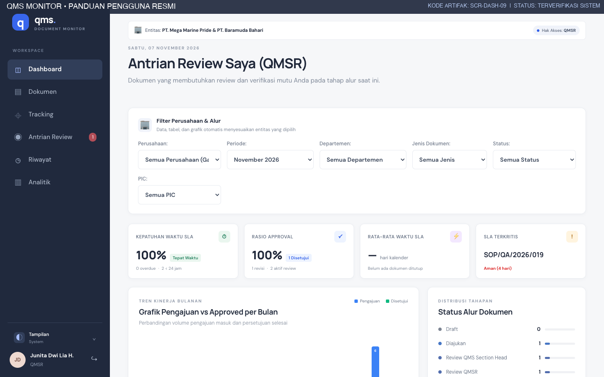
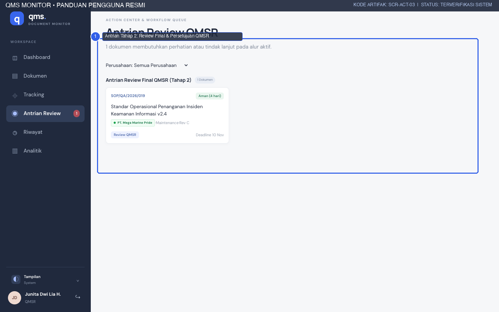
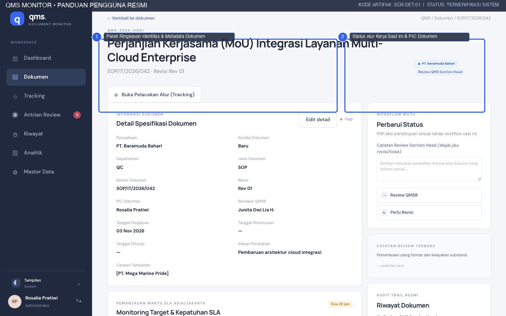
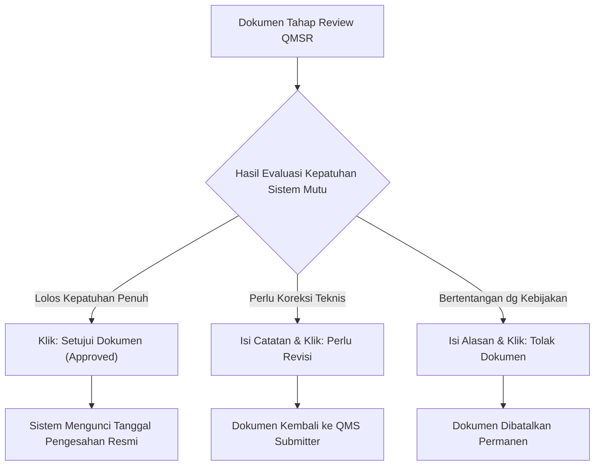
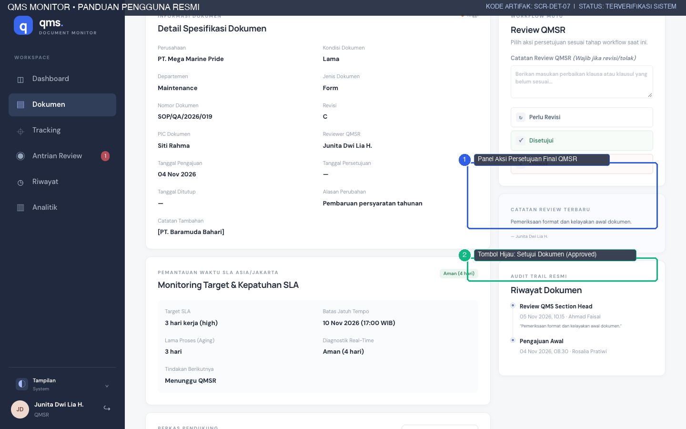
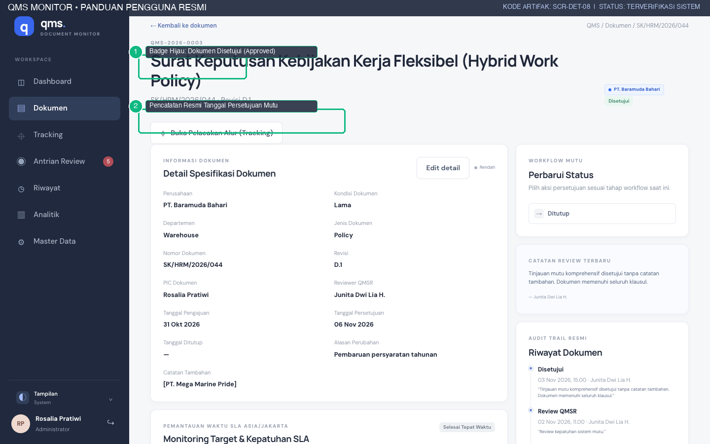
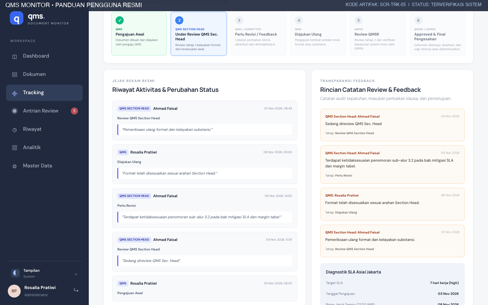

# PANDUAN PENGGUNA WAKIL MANAJEMEN MUTU (QMSR)
## QMS MONITOR — MODUL PENELAAHAN AKHIR & PENGESAHAN DOKUMEN (APPROVAL)
**PT. MEGA MARINE PRIDE & PT. BARAMUDA BAHARI**

---

| Informasi Dokumen | Detail |
|---|---|
| **Kode Dokumen** | `QMS-MMP-QMR-005` |
| **Versi Dokumen** | 1.0 (Edisi Produksi) |
| **Tanggal Efektif** | 7 November 2026 |
| **Sasaran Pengguna** | QMSR (Quality Management System Representative), Management Representative, Executive Approver |
| **Penyusun** | Technical Writer & Quality Assurance Team |
| **Penelaah Utama** | Rosalia Pratiwi & Junita Dwi Lia H. |
| **Klasifikasi Akses** | Internal Enterprise Restricted |

---

## 1. KEDUDUKAN & OTORITAS QMSR

Sebagai **Quality Management System Representative (QMSR)** di lingkungan **PT. Mega Marine Pride** dan **PT. Baramuda Bahari**, Anda memegang otoritas fungsional tertinggi dalam pengesahan sistem dokumentasi mutu perusahaan.

Peran dan tanggung jawab mutlak QMSR meliputi:
1. **Validasi Kepatuhan Standar Internasional:** Memastikan seluruh prosedur, petunjuk kerja, formulir, dan pedoman mutu patuh terhadap klausul standar akreditasi (ISO 9001:2015, HACCP Codex Alimentarius, BRCGS Global Standard for Food Safety Issue 9).
2. **Persetujuan Resmi (Final Approval):** Menerbitkan tanda persetujuan resmi digital yang mengunci keabsahan dokumen untuk diberlakukan di seluruh unit operasional pabrik.
3. **Pemberian Rekomendasi / Penolakan Kebijakan:** Mengembalikan dokumen yang memerlukan penyesuaian klausul mayor, atau menolak pengajuan dokumen yang bertentangan dengan kebijakan mutu korporat.
4. **Jaminan Integritas Audit:** Memastikan setiap dokumen yang disetujui memiliki ketertelusuran riwayat (*traceability*) yang kuat untuk kebutuhan inspeksi badan sertifikasi nasional maupun auditor eksternal pembeli (*buyer audit*).

### 1.1 Tampilan Dasbor Khusus QMSR
Saat masuk ke dalam sistem dengan akun peran QMSR, antarmuka otomatis mempersonalisasi dasbor:

*Gambar 1.1: Dasbor Terpersonalisasi Wakil Manajemen Mutu (QMSR) (SCR-DASH-09).*

Header dasbor secara eksplisit menegaskan: **Antrian Review Saya (QMSR)**, menyajikan jumlah dokumen yang siap diperiksa serta kartu metrik ketepatan SLA tahap akhir.

---

## 2. PENGELOLAAN ANTRIAN PENELAAHAN TAHAP 2 (`/actions`)

Untuk mengakses berkas-berkas yang telah ditugaskan kepada Anda oleh QMS Submitter dan telah divalidasi oleh Section Head:
1. Klik menu **Antrian Review** (`/actions`) pada navigasi sidebar.
2. Tampilan akan memusatkan perhatian pada kelompok: **Antrian Review Final QMSR (Tahap 2)**.

*Gambar 2.1: Antrian Penelaahan Final Tahap 2 QMSR (SCR-ACT-03).*

### 2.1 Ciri-Ciri Berkas Antrian QMSR:
- **Status Dokumen:** Berada pada tahap `Review QMSR (qmsr_review)`.
- **Indikator Reviewer:** Dokumen ditugaskan secara spesifik kepada nama Anda (*Junita Dwi Lia H.*).
- **Indikator SLA:** Menampilkan sisa waktu kerja sebelum batas tenggat waktu 17:00 WIB. Berkas yang tersisa $\le 1$ hari kerja akan ditandai dengan badge merah menyala pada kelompok *Review Terkritis*.

---

## 3. PROSEDUR EVALUASI SUBSTANSI & KLAUSUL MUTU

### 3.1 Membuka Dokumen & Memeriksa Naskah
1. Klik judul naskah atau nomor registrasi dokumen pada tabel antrian.
2. Pada halaman rincian dokumen (`/documents/[id]`), periksa informasi kunci:
   - **Perusahaan:** PT. Mega Marine Pride atau PT. Baramuda Bahari.
   - **Kategori & Judul:** Memastikan hierarki dokumen tepat (contoh: *Kebijakan/Policy*, *SOP*, *Work Instruction*).
   - **Alasan Perubahan:** Jika berstatus revisi, baca ringkasan latar belakang perubahan.
   - **Lampiran Naskah:** Unduh berkas draf akhir dan periksa paraf kelolosan verifikasi Section Head.

*Gambar 3.1: Halaman Rincian Metadata Dokumen pada Meja Telaah QMSR (SCR-DET-01).*

### 3.2 Daftar Periksa Evaluasi Kepatuhan QMSR:
- [ ] Apakah ruang lingkup dokumen mencakup seluruh departemen terkait?
- [ ] Apakah kriteria penerimaan mutu produk terukur secara ilmiah dan objektif?
- [ ] Apakah penanganan produk tidak sesuai (*Non-Conforming Product*) telah memenuhi ketentuan regulasi karantina perikanan?
- [ ] Apakah catatan review dari Section Head terdahulu telah diselesaikan seluruhnya?

---

## 4. OPSI KEPUTUSAN RESMI QMSR

Pada panel sebelah kanan **Review QMSR**, sistem menyediakan 3 (tiga) opsi tindakan alur kerja:

*Gambar 4.1: Panel Aksi Keputusan Resmi QMSR (SCR-DET-07) dengan Tombol Persetujuan Hijau dan Penolakan Merah.*

### 4.1 Keputusan A: Memberikan Persetujuan Resmi (`approved`)
Jika naskah dokumen telah memenuhi seluruh standar mutu korporat tanpa catatan perbaikan:
1. Kolom catatan review dapat diisi catatan pengesahan (misal: *“Tinjauan mutu komprehensif disetujui tanpa catatan tambahan. Dokumen memenuhi seluruh klausul ISO 9001:2015.”*).
2. Klik tombol hijau besar: **✓ Setujui Dokumen (Approved)**.
3. **Hasil yang Diharapkan:**
   - Status dokumen resmi berubah menjadi hijau: **Disetujui (`approved`)**.
   - Sistem mencatat stempel waktu pengesahan resmi secara permanen (*approval timestamp*).
   - Notifikasi status diperbarui ke dasbor QMS Submitter agar dapat segera diproses penutupan dan distribusi salinan terkendali.

*Gambar 4.2: Tampilan Dokumen yang Telah Resmi Disetujui oleh QMSR (SCR-DET-08).*

### 4.2 Keputusan B: Mengembalikan untuk Revisi Klausul (`need_revision`)
Jika naskah memerlukan perbaikan klausul teknis atau penambahan data dukung:
1. Pada kotak teks **Catatan Review QMSR (Wajib jika revisi/tolak)**, ketik masukan klausul secara spesifik:
   *Contoh:* `“Klausul 5.2 mengenai batas toleransi formalin dan histamin wajib disesuaikan dengan regulasi terbaru Badan Karantina Ikan 2026. Lampirkan lembar referensi pengujian eksternal.”`
2. Klik tombol: **↻ Perlu Revisi**.
3. **Hasil yang Diharapkan:** Dokumen dikembalikan ke status `need_revision`, dan pengaju diminta mengunggah naskah perbaikan baru.

### 4.3 Keputusan C: Penolakan Dokumen Permanen (`rejected`)
Jika pengajuan dokumen dinilai tidak layak diterbitkan, melanggar kebijakan integritas bisnis, atau telah diakomodasi oleh prosedur lain:
1. Tuliskan alasan pembatalan secara komprehensif pada kotak teks catatan.
2. Klik tombol merah: **× Tolak Dokumen**.
3. **Hasil yang Diharapkan:** Dokumen berstatus `rejected`, siklus dokumen diakhiri secara permanen, dan dicatat dalam audit trail perusahaan.

---

## 5. TRANSPARANSI CATATAN FEEDBACK & AUDIT TRACKING

Setiap catatan korektif atau apresiasi yang diberikan oleh QMSR secara otomatis dipublikasikan pada kartu umpan balik di halaman **Tracking Document (`/tracking`)**:
- Pengaju, Section Head, dan auditor dapat membaca masukan penelaahan secara transparan.
- Hal ini mencegah terjadinya perbedaan interpretasi dalam rapat tinjauan manajemen (*Management Review Meeting*).

*Gambar 5.1: Kartu Transparansi Catatan Umpan Balik Reviewer pada Modul Tracking (SCR-TRK-05).*

---

## 6. KESIMPULAN & TATA KELOLA TANDA TANGAN DIGITAL

Dengan terselesaikannya persetujuan di QMS Monitor:
1. Tidak diperlukan lagi tanda tangan fisik basah yang memakan waktu sirkulasi berminggu-minggu.
2. Setiap pengesahan terikat pada akun resmi QMSR dengan catatan jejak audit yang memenuhi persyaratan regulasi dokumen elektronik ISO 9001:2015 Klausul 7.5 (*Documented Information*).
